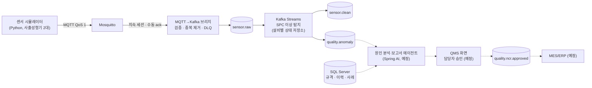

# QualiGuard Agent

> 설비 센서 데이터가 이상해지면, AI가 원인을 추정해 품질 담당자에게 **근거가 첨부된 부적합 보고서 초안**을 올려 주는 품질관리(QMS) 지원 에이전트

사출성형 라인의 센서 데이터를 MQTT로 수집하고, Kafka에서 SPC(통계적 공정 관리)로 이상을 탐지한 뒤, LLM 에이전트가 원인을 추정해 부적합(NCR) 보고서 초안을 작성합니다. 최종 승인은 품질 담당자가 하고, 승인 결과는 MES/ERP로 연계됩니다.

---

## 프로젝트 요약

| 구분 | 내용 | 상태 |
|---|---|---|
| **문제** | 설비 상태가 서서히 나빠지면 불량이 생긴 뒤에야 알아채고, 원인을 찾으려면 담당자가 센서 그래프·검사 결과·과거 이력·정비 기록을 일일이 뒤져 부적합 보고서를 써야 함 | — |
| **데이터** | 설비 센서 7종(온도·압력·쿠션량 등)의 shot 단위 공정 데이터, 비전 검사 결과, 검사 규격, 과거 부적합·조치 이력, 설비 정비 이력 | 센서·검사 ✅ / 나머지 예정 |
| **엔지니어링** | ① 수집·정제: MQTT → Kafka 브리지(검증·중복 제거·DLQ) ② 탐지: SPC 관리도 4종(규칙 기반, LLM 미사용) ③ 분석 에이전트: 경보 발생 시 센서 추이·규격·유사 사례·정비 이력을 도구로 조회해 원인 추정 ④ 보고서 에이전트: 근거가 달린 부적합 보고서 초안 → 담당자 승인 | ①② ✅ / ③④ 예정 |
| **산출물** | 이상 발생 시 근거가 첨부된 부적합 보고서 초안이 자동으로 올라오는 QMS 화면, 과거 부적합 사례 지식저장소, MES/ERP 연계 이벤트 | 예정 |
| **성과** | (시뮬레이션) 고장 3종 모두 **첫 불량 발생 전에 감지**, 정상 구간 오경보 2건, LLM 호출 대상을 전체 데이터의 **2.4%**로 제한 / 원인 추정 정확도는 측정 예정 | 일부 ✅ |

### 핵심 성과 (시뮬레이션, 설비 2대 × 2,000 shot)

| 지표 | 결과 |
|---|---|
| 실제 고장 3종 탐지 | **3/3**, 탐지 지연 35~45 shot, **모두 첫 불량 발생 전에 경보** |
| 센서 이상(가짜 이상) 구분 | 7 shot 만에 탐지, 품질 영향 0건 → 에이전트가 "센서 점검"으로 판단할 근거 확보 |
| 정상 구간 오경보 | 2건 (정상 2,200 shot × 센서 7종) |
| LLM 호출 대상 | 4,000 shot 중 경보 97건 (**2.4%**) |
| 중복 메시지 | 재주입 50건 중 50건 차단 |

자세한 측정 방법과 한계는 [평가 결과](docs/evaluation.md)를 참고하세요.

---

## 아키텍처



| 계층 | 기술 | 역할 |
|---|---|---|
| 수집 | Python, paho-mqtt, Eclipse Mosquitto | 설비 역할의 시뮬레이터가 shot마다 공정 데이터 발행 |
| 연계 | Spring Boot 4, Eclipse Paho MQTT v5, Apache Kafka 4 (KRaft) | 검증, 중복 제거, DLQ, 설비 ID 기준 순서 보장 |
| 탐지 | Kafka Streams (exactly-once v2, RocksDB 상태 저장소) | SPC 관리도 4종으로 이상 판정, 에이전트용 근거 생성 |
| 저장 | SQL Server 2025 | 규격, 측정 집계, 이상·부적합·정비 이력 (예정) |
| AI | Spring AI 2.0, MCP 도구 | 원인 추정, 보고서 초안 (예정) |
| 화면 | Spring Boot, jQuery, Kendo UI | QMS 승인 화면 (예정) |

자세한 내용은 [아키텍처 문서](docs/02-architecture.md)를 참고하세요.

---

## 핵심 의사결정

| 번호 | 결정 | 이유 |
|---|---|---|
| [ADR-001](docs/decisions/ADR-001-shot-level-message.md) | MQTT 메시지를 센서별이 아닌 **shot 단위**로 묶음 | 같은 shot의 값끼리 함께 봐야 원인 분석이 가능 |
| [ADR-002](docs/decisions/ADR-002-synthetic-data.md) | 합성 데이터 주력 + 공개 데이터(SECOM) 보조 | LLM이 원인을 설명하려면 센서의 의미가 필요 |
| [ADR-003](docs/decisions/ADR-003-local-sql-server.md) | SQL Server를 로컬 컨테이너로 운영 | M1(8GB)에서 실행·메모리를 직접 측정한 뒤 결정 |
| [ADR-004](docs/decisions/ADR-004-paho-direct-client.md) | MQTT 어댑터 대신 Paho 클라이언트 직접 사용 | 지속 세션 재접속 시 교착 상태 해결 |
| [ADR-005](docs/decisions/ADR-005-spc-detect-llm-reason.md) | **탐지는 SPC, 판단은 LLM** | 비용·설명 가능성·현장 신뢰 |
| [ADR-006](docs/decisions/ADR-006-kafka-streams-state.md) | Kafka Streams 상태 저장소 + exactly-once | 재시작해도 기준값 유지, 경보 중복 방지 |

---

## 진행 상황

| 단계 | 내용 | 상태 |
|---|---|---|
| 1 | 센서 시뮬레이터 → MQTT | ✅ |
| 2 | MQTT → Kafka 브리지 (검증·중복 제거·DLQ·수동 ack·지속 세션) | ✅ |
| 3 | 전처리·이상 탐지 (Kafka Streams + SPC 관리도 4종) | ✅ |
| 4 | SQL Server 적재 (규격·집계·이력·부적합) | 진행 예정 |
| 5 | 원인 분석·보고서 에이전트 (Spring AI + MCP 도구) | 예정 |
| 6 | QMS 화면·승인·MES/ERP 연계 | 예정 |

---

## 폴더 구성

| 경로 | 내용 |
|---|---|
| `simulator/` | 사출성형 라인 센서 시뮬레이터 (고장 시나리오 4종, 평가용 정답 기록) |
| `qms-app/` | Spring Boot 4 애플리케이션 — `bridge/`(MQTT→Kafka), `quality/`(SPC 이상 탐지) |
| `infra/` | Mosquitto 설정, SQL Server 초기화 스크립트 |
| `docs/` | 문제 정의, 아키텍처, 의사결정 기록(ADR), 장애 분석, 평가 결과 |
| `docker-compose.yml` | Mosquitto, Kafka(+토픽 생성), SQL Server(+DB 생성), Kafka UI(선택) |

---

## 로컬 실행

필요한 것: Docker(OrbStack 등), Java 21, Python 3.12 + [uv](https://docs.astral.sh/uv/)

```bash
# 1) 인프라
cp .env.example .env                     # MSSQL_SA_PASSWORD 입력
docker compose up -d                     # Mosquitto, Kafka, SQL Server
docker compose ps -a                     # kafka-init, mssql-init 은 Exited (0) 이 정상

# 2) 애플리케이션 (브리지 + 이상 탐지)
cd qms-app
./gradlew test --tests '*SpcEngineTest'  # 이상 탐지 단위 테스트 (인프라 불필요)
./gradlew bootRun

# 3) 시뮬레이터 (다른 터미널)
cd simulator
uv sync
uv run qg-simulator --interval 0.05      # 설비 2대 × 2,000 shot, 고장 시나리오 4종

# 4) 결과 확인
docker exec qg-kafka /opt/kafka/bin/kafka-console-consumer.sh \
  --bootstrap-server localhost:9092 --topic quality.anomaly --from-beginning \
  --max-messages 3 --property print.key=true
curl -s "localhost:8080/actuator/metrics/qg.bridge.messages?tag=result:published"
```

| 서비스 | 주소 |
|---|---|
| MQTT | `localhost:1883` |
| Kafka | `localhost:9092` |
| SQL Server | `localhost:1433` (DB `QUALIGUARD`) |
| 앱 지표 | `http://localhost:8080/actuator/metrics` |
| Kafka UI | `http://localhost:8090` (`docker compose --profile tools up -d kafka-ui`) |

### Kafka 토픽

| 토픽 | 용도 |
|---|---|
| `sensor.raw` | 브리지가 검증해 기록한 원본 shot 데이터 (key = 설비 ID) |
| `sensor.clean` | 중복 제거·범위 검사를 거친 정제 데이터 |
| `quality.anomaly` | 이상 탐지 결과 + 에이전트용 근거(최근 값, 센서별 z 점수, 불량 유형) |
| `quality.ncr.approved` | 담당자가 승인한 부적합 (MES/ERP 연계, 예정) |
| `quality.dlq` | 형식 오류 메시지 (오류 사유 헤더 포함) |

### 개발 환경 메모

- Apple Silicon(M1)에서는 SQL Server 이미지를 Rosetta로 실행합니다 (`orb config set rosetta true`).
- 8GB RAM 환경을 고려해 컨테이너별 메모리 상한과 JVM 힙(384MB)을 제한했습니다.

---

## 문서

- [문제 정의](docs/01-problem-definition.md) — 누구의 어떤 문제를 풀려는가
- [아키텍처](docs/02-architecture.md) — 구성 요소, 메시지 형식, 전달 보장 설계
- [의사결정 기록](docs/decisions/README.md) — ADR-001 ~ 006
- [장애 분석](docs/troubleshooting/README.md) — 개발 중 겪은 문제와 해결 과정
- [평가 결과](docs/evaluation.md) — 측정 방법, 결과, 한계
- [품질 담당자용 요약](docs/for-quality-team.md) — 기술 용어 없이 쓴 한 장 소개

> 이 프로젝트의 데이터는 시뮬레이터가 만든 합성 데이터이며, 성과 수치는 모두 시뮬레이션 환경에서 측정한 값입니다.
