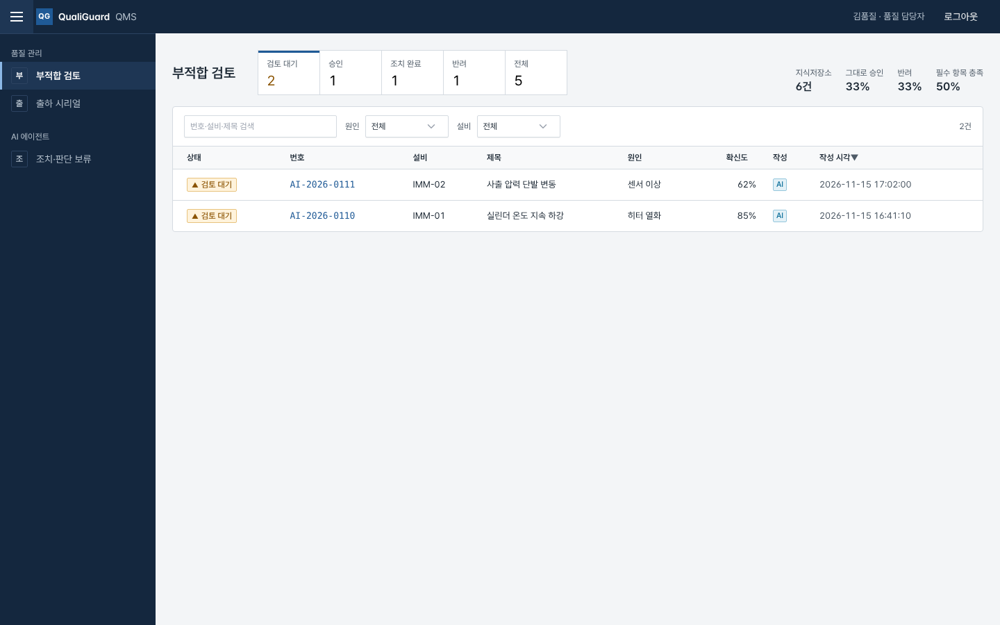
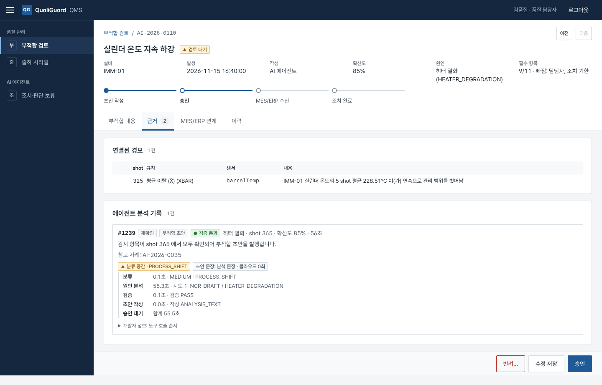
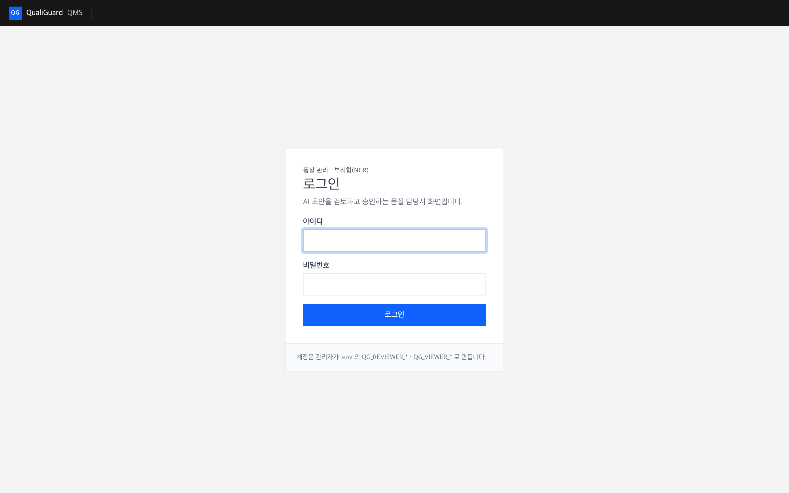
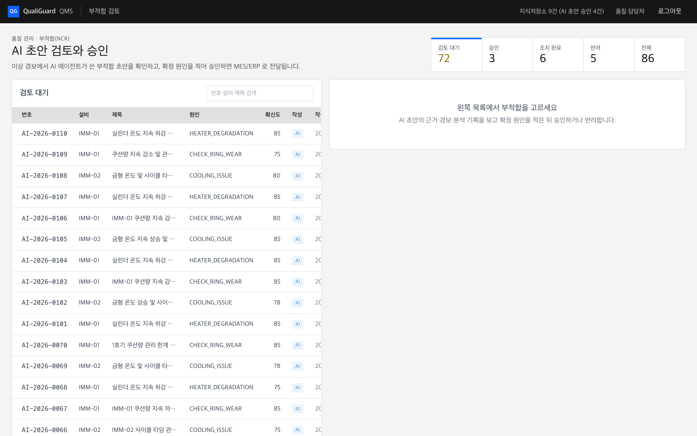
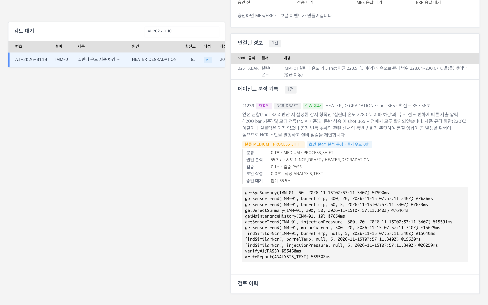
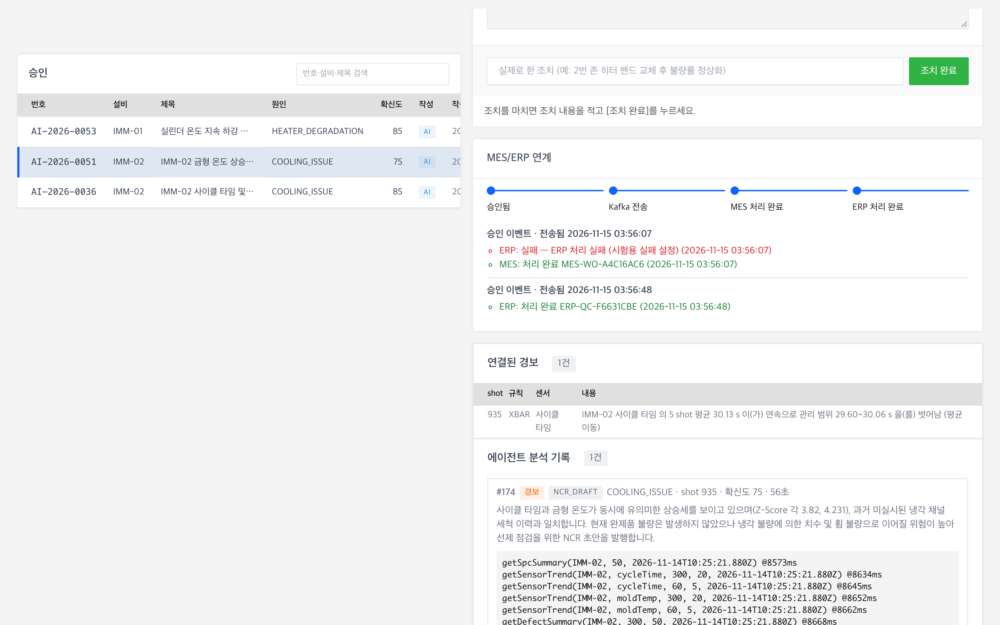
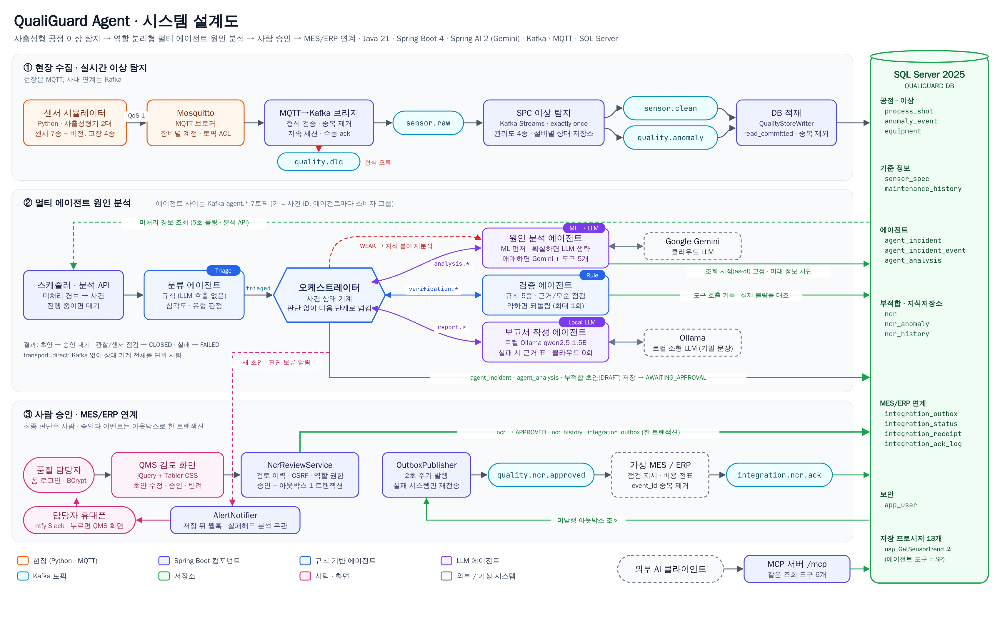

# QualiGuard Agent

[](https://github.com/choiminjeong0623/qualiguard-agent/actions/workflows/ci.yml)

> 설비 센서 데이터가 이상해지면, AI가 원인을 추정해 품질 담당자에게 **근거가 첨부된 부적합 보고서 초안**을 올려 주는 품질관리(QMS) 지원 에이전트

사출성형 라인의 센서 데이터를 MQTT로 수집하고, Kafka에서 SPC(통계적 공정 관리)로 이상을 탐지한 뒤, LLM 에이전트가 원인을 추정해 부적합(NCR) 보고서 초안을 작성합니다. 최종 승인은 품질 담당자가 하고, 승인 결과는 MES/ERP로 연계됩니다.

### 한눈에 보기 (시뮬레이션 기준)

| 원인 진단 (현재 main) | 처음 보는 고장 진단 | 잘못 만든 초안 | 분석 1단계 시간 | 고장 진단 시점 |
|:---:|:---:|:---:|:---:|:---:|
| **15/15** | **25/25** | **0건** | 평균 **62초** | **9/9, 첫 불량 전** |
| 시간 순 재생 3회 (2026-11-24 E3 재평가) | 과거 사례·정비 이력을 모두 숨기고 5회 (11-15) | 재생 평가 전체 | 43~81초, 1분 초과 11/19, 분석당 약 $0.018 | 실제 고장 3종 × 3회, 진단까지 불량 0건 |

```
경보 → 분류 → 원인 분석 ⇄ 검증 → 초안 작성 → 품질 담당자 검토·승인 → MES/ERP 점검 지시·비용 전표 → 응답 확인
       └──────── 에이전트끼리는 Kafka 이벤트로 이어짐 ────────┘
```

- **탐지는 규칙(SPC), 판단은 LLM**: LLM 호출은 전체 shot의 2.4%(경보)에만, 사건 단위로 묶어 더 줄입니다.
- **미래 정보 차단**: 에이전트는 경보 시점까지의 데이터·경보·지식저장소만 봅니다. 이 원칙 위에서 시간 순 재생으로 평가했습니다.
- **사람이 승인**: AI는 초안만 쓰고, 확정 원인을 적어 승인한 사례만 다음 분석의 지식저장소가 됩니다.
- **한계도 그대로 적었습니다**: [아래 "한계"](#한계)와 [평가 결과](docs/evaluation.md) 참고.

### 데모 화면

[](docs/demo/qualiguard-demo.mp4)

[사용자용 영상 mp4 (3분 14초, 자막 포함)](docs/demo/qualiguard-demo.mp4): 리디자인한 QMS 화면 — 데이터 흐름 → 담당자 휴대폰 알림(새 초안) → 검토 대기 목록·거르개 → 에이전트 흐름(ML 선판단, 애매하면 LLM) → AI 초안·근거·에이전트 분석 기록 → 확정 원인·조치 지정·승인 → MES/ERP 연계 → 판단 보류 알림 → 보류 검토 → 위험도 자동 조치·효과 검증 → 폐쇄망 모드. 화면 데이터는 시연용 예시이며, 자막은 1초에 7자 정도로 읽을 수 있게 맞췄습니다.

[개발자용 영상 mp4 (2분 34초, 시스템 뒤 흐름)](docs/demo/qualiguard-dev-demo.mp4): 인프라(docker compose)·센서 시뮬레이터 → Kafka UI(sensor.raw · sensor.clean · quality.anomaly) → 경보 1건 실시간 분석(분류 → 원인 분석 → 검증 → 초안, agent.* 토픽 · 사건 이벤트) → QMS 화면의 새 초안과 분석 기록

경보 → 분류 → 원인 분석 ⇄ 검증 → 초안 → 품질 담당자 승인 → MES/ERP

**QMS 화면 (2026-11-23 리디자인)**: 목록 → 전체 폭 상세(탭 + 하단 고정 동작 바), 상태는 모양·문구·색으로 표시. [전후 비교](docs/ui-redesign/README.md) · [ADR-009 결정 6](docs/decisions/ADR-009-qms-review-screen.md)

| 검토 대기 목록 | 부적합 상세 · 근거 탭 |
|:---:|:---:|
| [](docs/ui-redesign/after/desktop-ncr-list.png) | [](docs/ui-redesign/after/desktop-ncr-evidence.png) |
| 상태 탭·검토 지표, 거르개·정렬 | 처리 단계, 연결된 경보, 에이전트 분석 기록(검증·단계별 시간) |

아래 사진은 리디자인 전 화면이며 실제 데이터로 찍었습니다.

| 1. 로그인 | 2. 검토 대기 목록 |
|:---:|:---:|
| [](docs/demo/01-login.png) | [](docs/demo/02-list.png) |
| 검토자·조회자 계정 (역할별 권한) | 상태별 부적합 수, AI가 쓴 초안 목록 |
| **3. AI 초안 + 에이전트 분석 기록** | **4. 승인 후 MES/ERP 연계** |
| [](docs/demo/03-draft-agent-analysis.png) | [](docs/demo/04-approved-mes-erp.png) |
| 분류 MEDIUM · PROCESS_SHIFT, 단계별 시간(원인 분석 55.3초 · 검증 PASS · 합계 55.5초), 도구 호출 기록 | 승인됨 → Kafka 전송 → MES·ERP 처리 완료, 실패한 시스템만 다시 보냄 |

---

## 프로젝트 요약

| 구분 | 내용 | 상태 |
|---|---|---|
| **문제** | 설비 상태가 서서히 나빠지면 불량이 생긴 뒤에야 알아채고, 원인을 찾으려면 담당자가 센서 그래프·검사 결과·과거 이력·정비 기록을 일일이 뒤져 부적합 보고서를 써야 함 | — |
| **데이터** | 설비 센서 7종(온도·압력·쿠션량 등)의 shot 단위 공정 데이터, 비전 검사 결과, 검사 규격, 과거 부적합·조치 이력, 설비 정비 이력 | ✅ |
| **엔지니어링** | ① 수집·정제: MQTT → Kafka 브리지(검증·중복 제거·DLQ) ② 탐지: SPC 관리도 4종(규칙 기반, LLM 미사용) ③ 원인 분석 에이전트: 경보를 사건 단위로 묶어, 센서 추이·공정 능력·불량·유사 사례·정비 이력을 도구(저장 프로시저)로 조회해 원인 추정 ④ 근거가 달린 부적합 보고서 초안 작성 → 담당자 승인 | ①②③④ ✅ / 검토 화면 ✅ |
| **산출물** | 근거가 첨부된 부적합 보고서 초안(✅), 과거 부적합 사례 지식저장소(✅, 승인한 AI 초안이 다시 쌓임), 판단 과정을 남기는 분석 기록(✅), QMS 검토 화면(✅), MES/ERP 연계 이벤트(✅, 가상 수신) | ✅ |
| **성과** | (시뮬레이션) 고장 3종 모두 **첫 불량 발생 전에 감지**, 에이전트 시간 순 재생 평가 **15/15**(현재 main 3회, 고장 3종 모두 첫 불량 전 진단), 과거 사례·정비 이력을 숨긴 처음 보는 고장 **25/25**(5회), 잘못된 초안 0건, 근거 수치 일치율 **94%**, 분석 1단계 평균 **62초**(1분 목표는 아직 초과), LLM 호출 대상을 전체 데이터의 **2.4%**로 제한 | 일부 ✅ |

### 핵심 성과 (시뮬레이션, 설비 2대 × 2,000 shot)

| 지표 | 결과 |
|---|---|
| 실제 고장 3종 탐지 | **3/3**, 탐지 지연 35~45 shot, **모두 첫 불량 발생 전에 경보** |
| 센서 이상(가짜 이상) 구분 | 7 shot 만에 탐지, 품질 영향 0건 → 에이전트가 "센서 점검"으로 판단할 근거 확보 |
| 정상 구간 오경보 | 2건 (정상 2,200 shot × 센서 7종) |
| LLM 호출 대상 | 4,000 shot 중 경보 97건 (**2.4%**), 사건 단위로 묶어 더 줄임 |
| 에이전트 원인 추정 | 경보를 발생 순서대로, 그 시점까지의 데이터만으로 판단하는 **시간 순 재생 평가(5건 × 3회)에서 15/15** (현재 main 재평가 E3, 2026-11-24), 잘못 만든 초안 0건, 검증 에이전트 되돌림 0회, 진단까지 LLM 호출 사례당 1~2회. **고장 3종 9번 실행 모두 첫 불량 전에 진단, 진단까지 불량 0건** (히터 열화 +43~46 / 첫 불량 +68, 냉각 막힘 +39 / +116, 체크 링 +37 / +39). 센서 이상은 첫 경보(+7)에서 센서 점검. 정답 원인의 과거 사례를 숨겨도 15/15(11-15) → [평가 방식 허점 분석](docs/troubleshooting/04-agent-evaluation-leakage.md), [E3 결과](eval/results/20261124-1440_0467ab7-dirty_base-e3/summary.md) |
| 원인 평가 지표 (E5) | 정답이 후보 원인 3개 안에 든 비율 **100%**, 근거에 쓴 수치가 도구 결과와 맞은 비율 **94%**(416개), 인용한 과거 사례가 실제로 있는 비율 **100%** |
| 초안 작성 시간·비용 | 분석 1단계 평균 **62.2초**, 43~81초 (1분 초과 11/19단계, P95 79.5초). 도구·출력 항목이 늘어 11-15(평균 44초)보다 느려짐. 분석당 입력 약 4.9만·출력 1.2천 토큰, **약 $0.018**(예시 단가) |
| 중복 메시지 | 재주입 50건 중 50건 차단 |
| 처음 보는 고장 (과거 사례·정비 이력 숨김) | 5회 반복 **25/25**, 잘못된 초안 0건. 센서 이상은 첫 경보를 단발성으로 본 뒤 재확인(+47 shot)에서 진단, 확신도는 낮아짐 ([평가 2-8절](docs/evaluation.md)) |
| 공개 실제 데이터 (UCI SECOM) | 같은 탐지 규칙을 센서 448개에 적용하면 **경보 과다(100건당 205건), 불합격 구분 못함** → 규칙은 의미가 알려진 소수 센서용, 실제 적용에는 센서 고르기·다변량 관리도 필요 ([평가 2-9절](docs/evaluation.md)) |

자세한 측정 방법과 한계는 [평가 결과](docs/evaluation.md)를 참고하세요.

---

## 아키텍처



> 에이전트 파이프라인·사건 상태·승인 연계 순서도는 [시스템 설계도 문서](docs/04-architecture-diagram.md)에 있습니다. 아래는 텍스트로 본 같은 흐름입니다.

```mermaid
flowchart LR
    SIM["센서 시뮬레이터<br/>(Python, 사출성형기 2대)"] -- "MQTT QoS 1" --> MQ["Mosquitto"]
    MQ -- "지속 세션 · 수동 ack" --> BR["MQTT→Kafka 브리지<br/>검증 · 중복 제거 · DLQ"]
    BR --> RAW[("sensor.raw")]
    RAW --> SPC["Kafka Streams<br/>SPC 이상 탐지<br/>(설비별 상태 저장소)"]
    SPC --> CLEAN[("sensor.clean")]
    SPC --> ANO[("quality.anomaly")]
    CLEAN --> DB[("SQL Server<br/>공정 · 이상 · 규격 · 정비 · 부적합")]
    ANO --> DB
    DB -- "미처리 경보" --> AG["에이전트 파이프라인 (Kafka agent.*)<br/>분류 → ML 선판단(확실하면 LLM 생략)<br/>→ 원인 분석(Gemini, 도구=저장 프로시저)<br/>⇄ 검증(규칙) → 초안 작성(기본: 분석 문장, 실험: 로컬 모델)"]
    AG -- "부적합 초안 · 분석 기록" --> DB
    AG -. "새 초안 · 판단 보류" .-> PH["담당자 휴대폰 알림<br/>(ntfy 앱 푸시 · Slack)"] -. "누르면 해당 화면" .-> QMS
    DB --> QMS["QMS 검토 화면<br/>담당자 수정 · 승인 · 반려"]
    QMS -- "승인 + 이벤트 (같은 트랜잭션, 아웃박스)" --> APR[("quality.ncr.approved")] --> MES["가상 MES/ERP<br/>점검 지시 · 비용 전표 (중복 제거)"]
    MES -- "수신 확인 · 처리 완료(번호) · 실패" --> ACK[("integration.ncr.ack")] --> QMS
```



| 계층 | 기술 | 역할 |
|---|---|---|
| 수집 | Python, paho-mqtt, Eclipse Mosquitto | 설비 역할의 시뮬레이터가 shot마다 공정 데이터 발행 |
| 연계 | Spring Boot 4, Eclipse Paho MQTT v5, Apache Kafka 4 (KRaft) | 장비 인증·토픽 ACL, 검증, 중복 제거, DLQ, 설비 ID 기준 순서 보장 |
| 탐지 | Kafka Streams (exactly-once v2, RocksDB 상태 저장소) | SPC 관리도 4종으로 이상 판정, 에이전트용 근거 생성 |
| 저장 | SQL Server 2025 | shot 공정 데이터, 이상·부적합·정비 이력, 검사 규격, 저장 프로시저 6개 |
| AI | Spring AI 2.0, Gemini 3.8 Flash, MCP 서버 | 사건 단위 원인 추정, 부적합 보고서 초안, 판단 과정 기록. 같은 조회 도구를 MCP(`/mcp`)로도 제공 |
| 화면 | Spring Boot 정적 페이지, jQuery, Tabler CSS, Spring Security | QMS 검토 화면: 로그인, 초안 수정·승인·반려, MES/ERP 진행 단계, 검토 이력 (`/qms/index.html`, 배치는 IBM Carbon 참고) |

자세한 내용은 [아키텍처 문서](docs/02-architecture.md)를 참고하세요.

---

## 핵심 의사결정

| 번호 | 결정 | 이유 |
|---|---|---|
| [ADR-001](docs/decisions/ADR-001-shot-level-message.md) | MQTT 메시지를 센서별이 아닌 **shot 단위**로 묶음 | 같은 shot의 값끼리 함께 봐야 원인 분석이 가능 |
| [ADR-002](docs/decisions/ADR-002-synthetic-data.md) | 합성 데이터 주력 + 공개 데이터(SECOM) 보조 | LLM이 원인을 설명하려면 센서의 의미가 필요 |
| [ADR-003](docs/decisions/ADR-003-local-sql-server.md) | SQL Server를 로컬 컨테이너로 운영 | M1(8GB)에서 실행·메모리를 직접 측정한 뒤 결정 |
| [ADR-004](docs/decisions/ADR-004-paho-direct-client.md) | MQTT 어댑터 대신 Paho 클라이언트 직접 사용 | 지속 세션 재접속 시 교착 상태 해결 |
| [ADR-005](docs/decisions/ADR-005-spc-detect-llm-reason.md) | **탐지는 SPC, 판단은 LLM** | 비용·설명 가능성·현장 신뢰 |
| [ADR-006](docs/decisions/ADR-006-kafka-streams-state.md) | Kafka Streams 상태 저장소 + exactly-once | 재시작해도 기준값 유지, 경보 중복 방지 |
| [ADR-007](docs/decisions/ADR-007-sqlserver-qms-schema.md) | shot 원본 저장 + 저장 프로시저 조회, **경보 당시까지의 데이터만** 분석 | 에이전트가 미래 데이터를 보지 않게 (평가 신뢰성) |
| [ADR-008](docs/decisions/ADR-008-agent-design.md) | 사건 단위 분석, **대응표 없이 지식저장소로 추론**, 사람 승인 | 비용·중복 방지, 정답 주입 없는 추론, 책임 소재 |
| [ADR-009](docs/decisions/ADR-009-qms-review-screen.md) | 검토 상태 규칙은 **저장 프로시저 한 트랜잭션**에, 승인에는 확정 원인 필수, 화면은 jQuery + Tabler CSS(빌드 없음) | 동시 요청에도 상태 규칙 유지, 지식저장소 품질, 라이선스·메모리 |
| [ADR-010](docs/decisions/ADR-010-ncr-integration-outbox.md) | 승인 결과는 **트랜잭션 아웃박스**로 Kafka 에, 받는 쪽은 event_id 로 중복 제거 | 승인과 이벤트가 따로 성공·실패하지 않게 |
| [ADR-011](docs/decisions/ADR-011-qms-login.md) | QMS **로그인**(DB 사용자·BCrypt), 역할 품질 담당자/조회 전용, 비밀번호는 `.env` 로만 | 승인자를 확실히, 비밀번호를 저장소에 남기지 않음 |
| [ADR-012](docs/decisions/ADR-012-mes-erp-ack.md) | MES/ERP **응답**은 단계 번호로 순서 유지, 응답 ID 로 중복 제거, **실패한 시스템에만** 다시 보내기 | 순서 뒤바뀜·중복·부분 실패에도 상태가 맞게 |
| [ADR-013](docs/decisions/ADR-013-mcp-server.md) | 에이전트 도구를 **MCP 서버**(`/mcp`)로도 노출, 기준 시점은 기준 경보 ID 로만 | 다른 AI 클라이언트도 같은 데이터·같은 미래 정보 차단 원칙 |
| [ADR-014](docs/decisions/ADR-014-ncr-vector-search.md) | 유사 사례 **의미 검색**: SQL Server 2025 `VECTOR` + Gemini 임베딩, 센서 일치 점수에 유사도를 더함 | 같은 DB·프로시저에서 상태·기준 시점 조건과 함께, 엉뚱한 사례가 앞서지 않게 |
| [ADR-015](docs/decisions/ADR-015-mqtt-device-auth.md) | **MQTT 장비 인증 + 토픽 ACL**: 사용자명 = 설비 ID, 장비는 자기 토픽 쓰기만, 브리지는 읽기만 | 데이터 시스템의 입구는 사람이 아니라 설비 → 가짜 데이터 주입·도청 차단 |
| [ADR-016](docs/decisions/ADR-016-multi-agent-pipeline.md) | **역할 분리형 멀티 에이전트**: 분류·검증은 규칙, 분석만 LLM, 단계마다 Kafka 토픽. 작성 단계는 기본이 분석 문장 그대로이고 로컬 모델 작성은 실험 기능 | 자기 검증(근거 없는 결론 되돌림), 단계별 시간·실패 추적 |

---

## 진행 상황

| 단계 | 내용 | 상태 |
|---|---|---|
| 1 | 센서 시뮬레이터 → MQTT | ✅ |
| 2 | MQTT → Kafka 브리지 (검증·중복 제거·DLQ·수동 ack·지속 세션) | ✅ |
| 3 | 전처리·이상 탐지 (Kafka Streams + SPC 관리도 4종) | ✅ |
| 4 | SQL Server 적재 (공정·이상·규격·정비·부적합, 저장 프로시저) | ✅ |
| 5 | 원인 분석 에이전트 (Spring AI + Gemini, 도구 = 저장 프로시저), 시간 순 재생 평가, MCP 서버 | ✅ |
| 6 | QMS 화면·승인·MES/ERP 연계 (로그인, 지식저장소 반영, 아웃박스 연계·응답) | ✅ |
| 7 | 의미 검색(벡터)·분석 시간 단축 등 | [향후 계획](docs/future-work.md) |

---

## 폴더 구성

| 경로 | 내용 |
|---|---|
| `simulator/` | 사출성형 라인 센서 시뮬레이터 (고장 시나리오 4종, 평가용 정답 기록) |
| `qms-app/` | Spring Boot 4 애플리케이션 — `bridge/`(MQTT→Kafka), `quality/`(SPC 이상 탐지), `store/`(DB 적재), `agent/`(원인 분석·검증 에이전트, `pipeline/` 분류·오케스트레이터·작성·Kafka 연결), `ncr/`(QMS 검토 API), `integration/`(아웃박스 발행·가상 MES/ERP), `resources/static/qms/`(검토 화면) |
| `scripts/` | `mqtt_users.sh`·`mqtt_tls.sh`·`test_mqtt_acl.sh`(MQTT 계정·TLS·권한 시험), `sql.sh`(쿼리 실행), `check_gemini.sh`(LLM 연결 점검), `evaluate_agent.py`(에이전트 평가), `fetch_secom.sh`(공개 데이터 SECOM 받기) |
| `infra/` | Mosquitto 설정, SQL Server 초기화 스크립트(스키마·기준 데이터·저장 프로시저) |
| `docs/` | 문제 정의, 아키텍처, 의사결정 기록(ADR), 장애 분석, 평가 결과 |
| `docker-compose.yml` | Mosquitto, Kafka(+토픽 생성), SQL Server(+DB 생성), Kafka UI(선택) |

---

## 로컬 실행

필요한 것: Docker(OrbStack 등), Java 21, Python 3.12 + [uv](https://docs.astral.sh/uv/), Gemini API 키

```bash
# 1) 인프라
cp .env.example .env                     # MSSQL_SA_PASSWORD, GEMINI_API_KEY, QMS 화면 계정(QG_REVIEWER_PASSWORD 등) 입력
./scripts/mqtt_users.sh                  # MQTT 장비·브리지 계정 만들기 (비밀번호는 .env 에 자동 생성, ADR-015)
echo "QG_AGENT_API_TOKEN=$(openssl rand -hex 32)" >> .env   # 에이전트 API·MCP 토큰 (평가 스크립트가 .env 에서 읽음)
# (선택, Q5) 앱 전용 DB 계정: sa 대신 읽기·쓰기·프로시저 실행만 되는 계정으로 앱이 접속 (mssql-init 이 만듦)
printf 'QG_DB_USERNAME=qg_app\nQG_DB_PASSWORD=%s\n' "Qg-$(openssl rand -hex 12)!" >> .env
# (선택, Q5) MQTT TLS 8883: 개발용 CA·인증서 생성 → 앱·시뮬레이터를 TLS 로
./scripts/mqtt_tls.sh && printf 'QG_MQTT_URL=ssl://localhost:8883\nMQTT_TLS_CA=infra/mosquitto/certs/ca.crt\n' >> .env
docker compose up -d                     # Mosquitto, Kafka, SQL Server
./scripts/test_mqtt_acl.sh               # (선택) 익명 거부·토픽 권한 시험 6항목 (+ 인증서가 있으면 TLS 3항목)
docker compose ps -a                     # kafka-init, mssql-init 은 Exited (0) 이 정상

# 2) 애플리케이션 (브리지 + 이상 탐지)
cd qms-app
./gradlew test --tests '*SpcEngineTest'  # 이상 탐지 단위 테스트 (인프라 불필요)
./gradlew containerTest                   # SQL Server 컨테이너에 DB 초기화 전체 + 승인 프로시저 (Docker 필요)
./gradlew detectionEval                   # 이상 탐지 seed 5개 채점 → eval/detection_report.md
./gradlew ewmaEval                        # 지금 규칙 vs EWMA 관리도 비교 → eval/ewma_report.md (A4)
./gradlew spotbugsMain                    # 정적 분석 (제외 이유는 config/spotbugs-exclude.xml, CI 에서도 실행)
./gradlew bootRun

# QMS 검토 화면: http://localhost:8080/qms/index.html  (.env 의 QG_REVIEWER_USERNAME / PASSWORD 로 로그인)

# 3) 시뮬레이터 (다른 터미널)
cd simulator
uv sync
uv run qg-simulator --interval 0.05      # 설비 2대 × 2,000 shot, 고장 시나리오 4종

# 4) 결과 확인
docker exec qg-kafka /opt/kafka/bin/kafka-console-consumer.sh \
  --bootstrap-server localhost:9092 --topic quality.anomaly --from-beginning \
  --max-messages 3 --property print.key=true
TOKEN=$(grep QG_AGENT_API_TOKEN .env | cut -d= -f2)      # /actuator/metrics 는 토큰 필요 (Q2)
curl -s -H "Authorization: Bearer $TOKEN" "localhost:8080/actuator/metrics/qg.bridge.messages?tag=result:published"
curl -s -H "Authorization: Bearer $TOKEN" "localhost:8080/actuator/metrics/qg.agent.stage?tag=stage:ANALYZING"  # 단계별 시간 P50·P95 (O2)
curl -s -H "Authorization: Bearer $TOKEN" "localhost:8080/actuator/metrics/qg.agent.result"                     # 사건 결과 수 (O2)
./scripts/sql.sh "EXEC dbo.usp_GetDefectSummary 'IMM-01', 2000, 200"
./scripts/ops_report.sh 7 ALL                       # 에이전트 운영 리포트: 실패율·지연 P50/P95·분석당 비용·되돌림율 (O3)

# 5) 원인 분석 에이전트 평가 (사례마다 LLM 호출)
python3 scripts/evaluate_agent.py                  # 기본 평가
python3 scripts/evaluate_agent.py --runs 3         # 반복 안정성
python3 scripts/evaluate_agent.py --runs 3 --hide-matching-ncr   # 지식저장소 제거 실험
./scripts/ab_eval.sh prefetch                      # A1: 도구 호출 에이전트 vs 도구 미리 조회 + LLM 1회 → eval/ab_prefetch.md
./scripts/ab_eval.sh vector                        # F4: 유사 사례 의미 검색 켬 vs 끔 → eval/ab_vector.md
```

| 서비스 | 주소 |
|---|---|
| MQTT | `localhost:1883` (계정 필요: 장비 = 설비 ID, 브리지 = `qg-bridge`) |
| Kafka | `localhost:9092` |
| SQL Server | `localhost:1433` (DB `QUALIGUARD`) |
| 앱 지표 | `http://localhost:8080/actuator/metrics` |
| Kafka UI | `http://localhost:8090` (`docker compose --profile tools up -d kafka-ui`) |

### Kafka 토픽

| 토픽 | 용도 |
|---|---|
| `sensor.raw` | 브리지가 검증해 기록한 원본 shot 데이터 (key = 설비 ID) |
| `sensor.clean` | 중복 제거·범위 검사를 거친 정제 데이터 |
| `quality.anomaly` | 이상 탐지 결과 + 에이전트용 근거(최근 값, 센서별 z 점수, 불량 유형) |
| `agent.incident.triaged` 외 6개 | 에이전트 사이 전달 (분류 → 분석 요청·완료 → 검증 요청·완료 → 작성 요청·완료). 키 = 사건 ID ([ADR-016](docs/decisions/ADR-016-multi-agent-pipeline.md)) |
| `quality.ncr.approved` | 담당자가 승인한 부적합 (아웃박스 발행 → 가상 MES/ERP 수신) |
| `integration.ncr.ack` | 가상 MES/ERP 의 처리 결과 응답 (수신 확인·처리 완료·실패 → QMS 연계 상태) |
| `quality.dlq` | 형식 오류 메시지 (오류 사유 헤더 포함) |

### 개발 환경 메모

- Apple Silicon(M1)에서는 SQL Server 이미지를 Rosetta로 실행합니다 (`orb config set rosetta true`).
- 8GB RAM 환경을 고려해 컨테이너별 메모리 상한과 JVM 힙(384MB)을 제한했습니다.

---

## 한계

| 한계 | 내용 |
|---|---|
| 합성 데이터 | 성과 수치는 모두 시뮬레이터 데이터에서 잰 값입니다. 고장 시나리오도 4종뿐입니다. |
| 공개 실제 데이터(SECOM) | 같은 탐지 규칙을 센서 448개에 적용하면 경보가 100건당 205건으로 과다하고 불합격을 구분하지 못했습니다(불합격 52.9% vs 합격 64.3%). 규칙은 의미가 알려진 소수 센서용입니다. |
| 분석 시간 | 1분 목표에 못 미칩니다. 현재 main 재평가(E3) 평균 62초, 1분 초과 11/19단계. 도구(SOP·의미 검색)와 출력 항목이 늘어 11-15(평균 44초)보다 느려졌습니다. |
| 체크 링 마모 | 첫 경보와 첫 불량 사이가 2~4 shot뿐입니다. E3 재평가에서는 3회 모두 첫 경보에서 진단해 첫 불량 전이었지만, 11-15 측정에서는 3회 중 2회 첫 불량과 같은 shot이었습니다. 여유가 거의 없어 탐지 시점이 병목입니다. |
| 실행 간 편차 | 처음 보는 고장 실험에서 같은 입력에도 냉각 막힘 진단 시점이 +35~+71 shot으로 흔들립니다. |
| 운영 보안 | MQTT 장비 인증·ACL과 TLS(8883, 선택)가 있지만 개발 편의로 평문 1883도 열어 둡니다. 작성·승인 분리, 내부망 제한은 아직 없습니다. |

### 실험 기능 (기본값 꺼짐)

아래 기능은 코드와 단위 시험은 있지만 **기본 설정에서는 꺼져 있고, 성과 수치에 쓰이지 않았습니다.** 켜서 쓰려면 설정을 바꿔야 합니다.

| 기능 | 켜는 설정 | 상태 |
|---|---|---|
| 로컬 소형 LLM 보고서 작성 (Ollama) | `qg.agent.writer.mode=local` | 기밀 자료를 클라우드로 보내지 않으려는 실험. 실패·시간 초과·**자료에 없는 수치를 쓰면** 근거 표 초안으로 대신함(A3). 평가 수치 없음 |
| 위험도 기반 자동 조치 + 효과 검증 | `qg.agent.action.enabled=true` | 가상 실행(설비에 명령을 보내지 않음) |
| 도구 미리 조회 + LLM 1회 | `qg.agent.analysis-mode=prefetch` | 에이전트 방식과 비교하기 위한 기준선(A1) |

기본 작성 방식은 `analysis-text`(원인 분석 에이전트가 쓴 문장을 그대로 초안에 씀)입니다.

Kafka 내구성, MQTT 유실 방지 범위, exactly-once 경계, 심각도 규칙, `/mcp` 인증 등 면접관 관점의 반박 10가지와 보완 우선순위는 [한계와 보완할 점](docs/05-limitations-and-improvements.md)에 코드 확인 결과와 함께 정리했습니다.

---

## 향후 계획

| 항목 | 상태 |
|---|---|
| 유사 사례 의미 검색 (SQL Server 2025 VECTOR + Gemini 임베딩) | main 에 머지(2026-11-21), E3 재평가(켬)에서 15/15. 켬·끔 비교(F4, 5사례): 정답·근거 품질 같고 끄면 비용 12% 적음 → 정확도 효과는 확인 못 함 ([eval/ab_vector.md](eval/ab_vector.md), `qg.knowledge.vector-enabled` 로 끌 수 있음) |
| 분석 1단계 1분 이내 (E3 평균 62초, P95 79.5초) | 분석마다 토큰 기록(`agent_analysis` 토큰 열) + 하루 토큰 예산을 넘으면 자동 분석 중지(`GET /api/agent/budget`, O5) |
| 체크 링 마모 탐지 시점 앞당기기 | 병목은 탐지(첫 경보와 첫 불량 사이 4 shot) → EWMA·CUSUM 검토 |
| 수백 개 센서 데이터(SECOM)용 다변량 관리도 | Hotelling T²·PCA 검토 |
| 작성·승인 분리, 에이전트 API·MCP 내부망 제한, 로그인 보강 | 운영 전 필요 |

자세한 이유와 다음 할 일은 [향후 계획](docs/future-work.md)에, 로컬 소형 LLM·MQTT 장비 인증·Redis 판단은 [별도 문서](docs/03-future-local-llm-and-device-security.md)에 있습니다.

---

## 문서

- [문제 정의](docs/01-problem-definition.md) — 누구의 어떤 문제를 풀려는가
- [아키텍처](docs/02-architecture.md) — 구성 요소, 메시지 형식, 전달 보장 설계
- [시스템 설계도](docs/04-architecture-diagram.md) — 전체 시스템, 에이전트 파이프라인, 사건 상태, 승인·연계 순서 그림
- [의사결정 기록](docs/decisions/README.md) — ADR-001 ~ 015
- [장애 분석](docs/troubleshooting/README.md) — 개발 중 겪은 문제와 해결 과정 (평가 방식의 허점을 찾은 과정 포함)
- [평가 결과](docs/evaluation.md) — 측정 방법, 결과, 한계
- [품질 담당자용 요약](docs/for-quality-team.md) — 기술 용어 없이 쓴 한 장 소개
- [향후 계획](docs/future-work.md) — 구현했지만 머지하지 않은 브랜치, 남은 측정, 탐지·운영 보강 후보
- [향후 계획: 로컬 LLM·장비 보안](docs/03-future-local-llm-and-device-security.md) — 로컬 소형 LLM, MQTT 장비 인증·ACL, Redis 판단
- [한계와 보완할 점](docs/05-limitations-and-improvements.md) — 면접관 관점의 반박 10가지: 현재 상태, 한계, 보완 우선순위
- [MES/ERP 연계 EAI 계획](docs/06-mes-erp-eai-plan.md) — 아웃박스는 유지하고 Kafka 대신 인터페이스 서버로 보내는 설계와 손코딩 체크리스트 (계획)
- [에이전트 설계·평가 산출물](docs/agent/README.md) — 도구 명세서, 프롬프트 정의·변경 이력, 메모리 아키텍처, 가드레일·폴백 정책 (도구 호출 상한 `qg.agent.max-tool-calls` 포함)

> 이 프로젝트의 데이터는 시뮬레이터가 만든 합성 데이터이며, 성과 수치는 모두 시뮬레이션 환경에서 측정한 값입니다.
