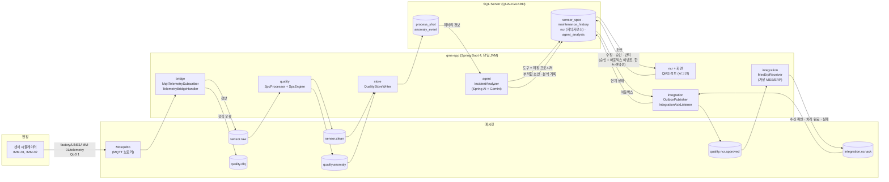

# 02. 아키텍처

> 그림으로 보려면 [04. 시스템 설계도](04-architecture-diagram.md)를 참고하세요.

## 1. 전체 흐름



현장 쪽은 가볍고 연결이 불안정해도 견디는 **MQTT**, 사내 시스템 쪽은 메시지를 디스크에 보관하고 여러 소비자가 다시 읽을 수 있는 **Kafka**를 씁니다. 실제 제조 현장에서 많이 쓰는 "현장은 MQTT, 사내 연계는 Kafka" 구성입니다.

## 2. 구성 요소

| 구성 요소 | 위치 | 역할 |
|---|---|---|
| 센서 시뮬레이터 | `simulator/` | 사출성형기가 shot마다 센서 7종과 비전 검사 결과를 발행. 고장 시나리오 4종 주입, 평가용 정답 CSV 기록 |
| Mosquitto | `docker-compose.yml`, `infra/mosquitto/` | MQTT 브로커. 지속 세션(persistence), 장비별 계정·토픽 ACL ([ADR-015](decisions/ADR-015-mqtt-device-auth.md)) |
| 브리지 | `qms-app/.../bridge/` | MQTT 구독 → 형식 검증 → 중복 제거 → Kafka 기록 → MQTT ack |
| 이상 탐지 | `qms-app/.../quality/` | Kafka Streams. 설비별 SPC 상태를 저장소에 두고 관리도 4종으로 판정 |
| Kafka | `docker-compose.yml` | KRaft 단일 노드. 토픽은 `kafka-init`이 명시적으로 생성 |
| DB 적재 | `qms-app/.../store/` | `sensor.clean`·`quality.anomaly`를 읽어 SQL Server에 저장 (`read_committed`, 중복 건너뜀) |
| 에이전트 파이프라인 | `qms-app/.../agent/`, `agent/pipeline/` | 역할 분리형: 분류(규칙) → 원인 분석(ML 선판단 → 애매하면 LLM) → 검증(규칙, 약하면 되돌림) → 보고서 작성(로컬 모델/근거 표) → 사람 승인. 단계마다 Kafka 토픽 `agent.*` ([ADR-016](decisions/ADR-016-multi-agent-pipeline.md)) |
| QMS 검토 | `qms-app/.../ncr/`, `resources/static/qms/` | 초안 수정·승인·반려·조치 완료, 검토 이력, 지식저장소 현황 (화면 `/qms/index.html`) |
| 모바일 경보 알림 | `qms-app/.../notify/` | 새 부적합 초안·판단 보류를 저장 뒤 담당자 휴대폰으로 (ntfy 앱 푸시·Slack 웹훅, `qg.notify.mode`, 기본 off) |
| 로그인·권한 | `qms-app/.../security/` | 폼 로그인, 사용자 `app_user`(BCrypt), 역할 품질 담당자/조회 전용 |
| MES/ERP 연계 | `qms-app/.../integration/` | 아웃박스 발행, 가상 MES/ERP 수신(별도 소비자 그룹), 처리 결과 응답 반영 |
| SQL Server | `docker-compose.yml`, `infra/mssql/init/` | 공정·이상·규격·정비·부적합 데이터, 저장 프로시저 6개 |

## 3. 메시지 형식

### MQTT / `sensor.raw` — shot 1건

```json
{
  "messageId": "b1c2…",
  "lineId": "LINE1",
  "equipmentId": "IMM-01",
  "shotNo": 301,
  "serialNo": "TMP-LINE1-IMM-01-261117-00301",
  "ts": "2026-11-14T16:20:01.123+09:00",
  "sensors": {
    "moldTemp":          {"value": 60.3,   "unit": "C"},
    "barrelTemp":        {"value": 229.1,  "unit": "C"},
    "injectionPressure": {"value": 1203.5, "unit": "bar"}
  },
  "inspection": {"result": "OK", "defectType": null},
  "bridge": {"receivedAt": "…", "sourceTopic": "factory/LINE1/IMM-01/telemetry"}
}
```
`bridge` 항목은 브리지가 추적용으로 덧붙입니다. Kafka 메시지 key는 `equipmentId`입니다.

**결측 허용 ([ADR-017](decisions/ADR-017-telemetry-nulls-serial.md))**: 필수는 `messageId`·`lineId`·`equipmentId`·`ts` 뿐이고,
없으면 DLQ 로 갑니다. `shotNo`·`inspection`·`serialNo` 는 없을 수 있고, `sensors` 는 비었거나 센서 일부가 빠지거나 `value` 가 null 일 수 있습니다.
- 값이 없는 센서는 SPC 에서 그 shot 만 invalid 로 빼고, 검사 결과가 없는 shot 은 불량률 집계에서 뺍니다(OK 로 세지 않음).
- 추적 키는 `messageId`(중복 제거)와 `equipmentId + shotNo + ts` 입니다. `serialNo` 는 공정 중 null·임시값(`TMP-…`)·중복이 정상이라 고유 키로 쓰지 않고 전달·적재만 합니다. 확정 시리얼은 출하 때 `shipment_serial_link` 에서만 고유합니다(표만 있음, 로직은 향후).
- 중복(같은 `messageId`)은 브리지·SPC·DB 세 층에서 거릅니다. 늦게 온 shot(`ts` 가 이미 판정한 shot 보다 앞섬)은 저장만 하고 실시간 관리도 판정은 건너뜁니다(`arrival_late`).
- 같은 센서가 5 shot 연속 비면 `[센서 끊김]` 로그와 `qg.spc.sensor_outage` 지표로 알립니다(이상 경보는 아님).
- 브리지는 빠진 항목을 `qg.bridge.missing_fields`(field, kind) 지표로 셉니다.

### `quality.anomaly` — 이상 탐지 1건 (에이전트 입력)

| 필드 | 의미 |
|---|---|
| `rule`, `ruleName` | 판정 규칙 (INDIVIDUAL, XBAR, S_CHART, P_CHART) |
| `sensor`, `observed` | 규칙에 걸린 센서와 값 |
| `baselineMean`, `baselineSigma`, `lowerLimit`, `upperLimit` | 기준값과 관리 한계 |
| `recentValues` | 해당 센서의 최근 값 30개 |
| `sensorZScores` | **모든 센서**의 최근 5 shot 평균이 기준에서 몇 σ 벗어났는지 — 원인 추정의 핵심 단서 |
| `recentNgRate`, `recentDefectTypes` | 최근 50 shot 불량률과 불량 유형별 건수 |
| `message` | 사람이 읽을 수 있는 한 줄 설명 |

### `quality.ncr.approved` — 승인 이벤트 (아웃박스 → 가상 MES/ERP)

| 필드 | 의미 |
|---|---|
| `eventId`, `eventType` | 이벤트 ID(수신 쪽 중복 제거 기준), `NCR_APPROVED` |
| `ncrNo`, `equipmentId`, `causeCode`, `rootCause`, `defectType`, `recommendedAction` | 승인된 부적합 내용 |
| `approvedBy`, `approvedAt`, `anomalyIds` | 승인자·시각, 연결된 경보 |
| `targetSystems` | 다시 보내기일 때 대상 시스템(예: `ERP`). 없으면 모든 시스템 |

Kafka 메시지 key 는 설비 ID, 헤더에 `eventId`.

### `integration.ncr.ack` — 가상 MES/ERP 응답

| 필드 | 의미 |
|---|---|
| `responseId` | 응답 ID — (이벤트, 시스템, 단계)에서 계산. QMS 중복 제거 기준 |
| `eventId`, `ncrNo`, `system` | 어느 이벤트에 대한 어느 시스템(MES/ERP)의 응답인지 |
| `status`, `seq` | `RECEIVED`(1) → `PROCESSED`(2) 또는 `FAILED`(2). seq 가 큰 응답만 상태를 바꿈 |
| `referenceNo`, `message` | 작업 지시·전표 번호, 실패 사유 |

Kafka 메시지 key 는 부적합 번호.

## 4. 전달 보장 설계

데이터가 사라지거나 두 번 처리되지 않도록 단계마다 장치를 두었습니다.

| 구간 | 위험 | 장치 |
|---|---|---|
| 시뮬레이터 → Mosquitto | 전송 중 유실 | QoS 1, 종료 전 미확인 메시지 대기 |
| Mosquitto → 브리지 | 브리지가 꺼진 동안 유실 | **지속 세션**(고정 client-id, cleanStart=false): 브로커가 메시지 보관 후 재접속 시 전달 |
| 브리지 → Kafka | 기록 실패인데 "받았다"고 응답 | **수동 ack**: Kafka 기록 성공 후에만 MQTT ack |
| QoS 1 재전송 | 같은 메시지 중복 | 브리지 메모리 중복 제거 (최근 10만 건) |
| 브리지 재시작 | 중복 제거 기록 소실 | 이상 탐지 단계에서 설비별 상태로 **한 번 더** 중복 제거 |
| Kafka 기록 재시도 | 같은 메시지 두 번 기록 | 멱등 프로듀서 (`enable.idempotence=true`, `acks=all`) |
| 이상 탐지 재처리 | 경보 중복 발행 | Kafka Streams **exactly-once v2** |
| DB 적재 | 같은 메시지 두 번 저장, 취소된 트랜잭션 메시지 저장 | `INSERT ... WHERE NOT EXISTS` + 고유 인덱스, `read_committed` |
| 에이전트 | 같은 원인의 보고서 중복 | 사건 단위 묶기, 같은 원인 초안이 있으면 연결 |
| 에이전트 사건 진행 중 앱 재시작 | 분석 중이던 사건이 사라지고 경보가 `ANALYZING` 에 머묾 | 단계마다 **사건 기록**(`agent_incident.checkpoint_json`)을 남기고, 켜질 때 되살려 멈춘 단계부터 이어 감. 같은 요청이 두 번 와도 상태·시도 번호로 한 번만 처리 ([ADR-016](decisions/ADR-016-multi-agent-pipeline.md) 3단계) |
| 형식 오류 | 조용히 버려짐 | DLQ에 오류 사유와 함께 보관 |
| 승인 → MES/ERP | 승인은 됐는데 이벤트가 사라짐 / 승인 안 된 건이 나감 | **트랜잭션 아웃박스**: 승인과 이벤트 기록을 한 트랜잭션, 발행은 Kafka 기록 확인 뒤에만 완료 표시 ([ADR-010](decisions/ADR-010-ncr-integration-outbox.md)) |
| 아웃박스 재발행 | 같은 승인 이벤트 두 번 수신 | 수신 쪽 `(event_id, 시스템)` 고유 제약 + `NOT EXISTS` |
| MES/ERP 응답 | 중복 응답, 늦게 온 낮은 단계 응답, 응답 유실 | `response_id` 중복 제거, seq 가 클 때만 상태 변경, 같은 이벤트 재수신 시 같은 응답 재전송 ([ADR-012](decisions/ADR-012-mes-erp-ack.md)) |

> **계획 (구현 전):** 승인 → MES/ERP 구간은 Kafka 대신 **인터페이스(EAI) 서버 REST 호출**로 바꿀 예정입니다. 아웃박스·`(event_id, 시스템)` 중복 제거·seq 응답 규칙은 그대로 두고, 발행기 재시도(지수 백오프)와 콜백 API 가 Kafka 토픽을 대신합니다. 승인은 하루 수십 건 수준이라 Kafka 의 처리량이 필요 없기 때문입니다. → [06. MES/ERP 연계 EAI 계획](06-mes-erp-eai-plan.md), [ADR-018](decisions/ADR-018-mes-erp-eai-interface-server.md)

## 5. 이상 탐지 (SPC)

| 단계 | 내용 |
|---|---|
| 기준 구간 (Phase I) | 설비별 처음 100 shot으로 센서별 평균(μ)·표준편차(σ), 기준 불량률 추정 |
| 개별값 | 한 값이 μ ± 4σ 밖 → 값 튐 |
| X̄ 관리도 | 5 shot 부분군 평균이 μ ± 3σ/√5 밖, **연속 2회** → 평균 이동 |
| S 관리도 | 부분군 표준편차가 1.964σ(B6, n=5) 초과, **연속 2회** → 산포 증가 |
| p 관리도 | 50 shot 구간 불량률이 p̄ + 4√(p̄(1−p̄)/50) 초과 → 불량률 증가 |
| 반복 억제 | 같은 규칙·센서 경보는 100 shot 동안 재발행하지 않음 |

핵심 로직(`SpcEngine`)은 Kafka·Spring에 의존하지 않는 순수 Java라 단위 테스트로 단독 검증합니다.

## 6. 자원 제약 (8GB RAM 개발 PC)

| 구성 요소 | 메모리 상한 |
|---|---|
| Mosquitto | 64MB |
| Kafka | 900MB (힙 512MB) |
| SQL Server | 2.5GB (엔진 내부 2GB) |
| qms-app | JVM 힙 384MB |

브리지·이상 탐지·에이전트·QMS 화면·연계(가상 MES/ERP 포함)를 **하나의 Spring Boot 앱 안에 모듈로** 둔 것도 JVM을 하나만 띄우기 위해서입니다. 운영 환경이라면 모듈별로 분리 배포할 수 있게 패키지를 나눠 두었습니다.

## 7. DB 설계 (SQL Server)

| 테이블 | 내용 |
|---|---|
| `equipment`, `sensor_spec` | 설비 마스터, 센서별 검사 규격(LSL/목표/USL) |
| `process_shot` | shot 단위 공정 데이터 (`sensor.clean` 적재) |
| `anomaly_event` | 이상 이력. 상태: NEW → ANALYZING → NCR_DRAFTED / DISMISSED |
| `maintenance_history` | 설비 정비 이력 |
| `ncr`, `ncr_anomaly` | 부적합 보고서(과거 사례 + 에이전트 초안)와 경보 연결 |
| `agent_analysis` | 에이전트 분석 기록: 판단, 원인, 확신도, 도구 호출 순서, 소요 시간, 경보/재확인 구분·기준 시점, 평가 실행 표시(`run_tag`), 분석 시도 수·검증 결과, 사건 번호·단계 기록(`pipeline_json`) |
| `agent_incident`, `agent_incident_event` | 파이프라인 사건 상태(분류·현재 단계·시도 수)와 단계마다 한 줄씩의 이동 기록 |
| `ncr_history` | 검토 이력: 수정(바뀐 항목 전·후)·승인·반려·조치 완료, 검토자 |
| `app_user` | QMS 화면 사용자 (BCrypt 해시, 역할) |
| `integration_outbox` | 승인 이벤트 아웃박스 (전송 시각·시도 횟수·오류) |
| `integration_receipt` | 가상 MES/ERP 가 만든 업무 (점검 작업 지시·비용 전표) |
| `integration_status`, `integration_ack_log` | MES/ERP 응답: 이벤트·시스템별 현재 상태, 받은 응답 전부 |

조회는 저장 프로시저로 제공하며, 에이전트 도구와 QMS 화면이 함께 씁니다. 검토·연계의 쓰기(`usp_UpdateNcrDraft`, `usp_ReviewNcr`, `usp_CloseNcr`, `usp_EnqueueNcrApproved`, `usp_ApplyIntegrationAck`)도 프로시저 하나가 상태 확인·변경·이력을 한 트랜잭션에서 처리합니다. 초기화 스크립트는 `infra/mssql/init/01~10, 13`이며 모두 다시 실행해도 안전합니다. 자세한 결정은 [ADR-007](decisions/ADR-007-sqlserver-qms-schema.md), [ADR-009](decisions/ADR-009-qms-review-screen.md)에 있습니다.

## 8. 원인 분석 에이전트

경보 1건은 역할이 나뉜 에이전트들을 차례로 거칩니다 (Kafka 토픽으로 연결, [ADR-016](decisions/ADR-016-multi-agent-pipeline.md)).

```
분류(규칙: 심각도·유형) → ML 선판단 ─확실→ 검증(규칙) ─PASS→ 보고서 작성 → 사람 승인 대기 ─→ 담당자 휴대폰 알림
                              └─애매·처음 보는 패턴→ 원인 분석(LLM, 아래 ①~⑤) ─┘   └─WEAK→ 지적을 붙여 되돌림 (최대 1회)
```

**ML 선판단 (ML 먼저, 애매하면 LLM)**: 시뮬레이터 고장으로 학습한 랜덤 포레스트(`CauseForest`, 경보 시점 특징 66개)가 먼저 원인 확률을 냅니다. 확률이 0.9 이상이고 학습한 경보들과 많이 다르지 않으면(novelty-check) LLM 을 부르지 않고 그 판단을 씁니다. 애매하거나 처음 보는 패턴, 단발성(NOISE)은 LLM 원인 분석으로 넘깁니다. 시뮬레이션 측정에서 경보 93~95% 가 LLM 없이 처리됐고 오답은 0건, 학습하지 않은 새 고장은 95% 를 LLM 으로 넘겼습니다([eval/ml_cascade_report.md](../eval/ml_cascade_report.md), [eval/ml_novel_report.md](../eval/ml_novel_report.md)). 기본은 꺼져 있고(`qg.agent.ml-triage.mode=off`), shadow 로 먼저 일치율을 본 뒤 skip 으로 켭니다.

**담당자 모바일 알림**: 새 부적합 초안이나 판단 보류가 저장되면 `AlertNotifier` 가 웹훅으로 알립니다. ntfy(휴대폰 앱 푸시, 공장 안 서버로도 운영 가능) 또는 Slack 을 고르고(`qg.notify.mode`), 알림을 누르면 해당 초안·보류 화면이 열립니다. 저장이 끝난 뒤 별도 스레드에서 보내므로 알림 서버가 꺼져 있어도 분석에는 영향이 없습니다. 확인: `GET /api/qms/notifications`, 시험 알림 `POST /api/qms/notifications/test`.

아래는 그중 원인 분석 에이전트의 흐름입니다.

```
미처리 경보 ─ ① 사건 묶기 (같은 설비, 100 shot·30분 안)
           ─ ② 조사 (도구 5개 = 저장 프로시저, 경보 당시까지의 데이터만)
                getSpcSummary → getSensorTrend → getDefectSummary → findSimilarNcr → getMaintenanceHistory
           ─ ③ 결과 (판단 / 원인 코드 / 확신도 / 현상 / 추정 원인 / 근거 / 참고 사례 / 권고 조치)
           ─ ④ 저장 (한 트랜잭션)
                NCR_DRAFT → 부적합 초안 (같은 원인 초안이 있으면 연결)
                SENSOR_CHECK, OBSERVE → 경보 종결
                + agent_analysis 기록
           ─ ⑤ 관찰(OBSERVE) 뒤 새 경보 없이 40 shot → 그 시점 데이터로 재확인 (최대 3회)
                이전 판단(watchItems 포함)을 넘겨 판단 갱신
```

지난 경보를 다시 분석할 때 미래 정보를 쓰지 않도록 세 경로를 모두 막았습니다: **데이터**(조회 기준 시점, ADR-007), **경보**(시간 순 재생에서는 시작 경보 시각까지의 경보만, [장애 분석 04](troubleshooting/04-agent-evaluation-leakage.md)), **지식저장소**(분석 시점까지 승인된 사례만, ADR-008 결정 6).

| API | 용도 |
|---|---|
| `GET /api/agent/anomalies` | 경보 목록 |
| `POST /api/agent/analyze-next` | 가장 오래된 미처리 사건 1건 분석 (분석 API 는 파이프라인 끝까지 기다려 결과를 돌려줌) |
| `POST /api/agent/analyze/{anomalyId}?replay=&tag=` | 지정 경보를 시작점으로 분석 (시간 순 재생 가능) |
| `POST /api/agent/recheck/{analysisId}?asOfShot=` | 관찰 판단 재확인 |
| `GET /api/agent/config` | 재확인 설정 |
| `GET /api/agent/analyses` | 분석 기록 |
| `POST /mcp` (MCP, streamable HTTP) | 같은 조회 도구 6개를 다른 AI 클라이언트에 제공. 기준 경보 ID 를 주면 그 시각까지만 ([ADR-013](decisions/ADR-013-mcp-server.md)) |

자동 분석은 기본으로 꺼져 있습니다 (`qg.agent.auto-enabled`). 자세한 결정은 [ADR-008](decisions/ADR-008-agent-design.md)에 있습니다.

## 9. QMS 검토와 MES/ERP 연계

```
AI 초안(DRAFT) ─ 품질 담당자 로그인 ─ 수정(이력: 바뀐 항목 전·후) ─┬─ 반려(사유 필수) → REJECTED
                                                                  └─ 승인(확정 원인·원인 코드 필수) → APPROVED
APPROVED ─┬─ 지식저장소: 승인 시각 이후의 분석에서 유사 사례로 검색
          ├─ 같은 트랜잭션에 아웃박스 이벤트 → 2초 안에 quality.ncr.approved 발행
          │      → 가상 MES(점검 작업 지시)·ERP(품질 비용 전표) → integration.ncr.ack 응답
          │      → 연계 상태: 수신 확인 → 처리 완료(번호) / 실패(사유) → 실패한 시스템에만 다시 보내기
          └─ 조치 완료(조치 내용 필수) → CLOSED (조치 내용도 다음 분석에서 참고)
```

> 위 연계 흐름은 **현재 구현(Kafka)** 입니다. 인터페이스(EAI) 서버로 바꾸는 계획은 [06 문서](06-mes-erp-eai-plan.md)에 있습니다.

| API (로그인 필요) | 권한 | 용도 |
|---|---|---|
| `GET /api/qms/ncrs?status=`, `GET /api/qms/ncrs/{ncrNo}` | 품질 담당자·조회 전용 | 목록, 상세(경보·분석 기록·연계 상태·검토 이력) |
| `PUT /api/qms/ncrs/{ncrNo}` | 품질 담당자 | 초안 수정 |
| `POST /api/qms/ncrs/{ncrNo}/approve` · `/reject` · `/close` | 품질 담당자 | 승인·반려·조치 완료 |
| `POST /api/qms/ncrs/{ncrNo}/integration/retry` | 품질 담당자 | 실패한 연계 다시 보내기 |
| `GET /api/qms/ncrs/knowledge`, `GET /api/qms/me` | 품질 담당자·조회 전용 | 지식저장소 현황, 로그인 사용자 |

쓰기 요청은 CSRF 토큰(`XSRF-TOKEN` 쿠키 → `X-XSRF-TOKEN` 헤더)이 필요합니다. 에이전트 API(`/api/agent/**`)와 actuator 는 로컬 평가 스크립트·모니터링용으로 열어 두었으며, 운영에서는 내부망 제한이 필요합니다 ([ADR-011](decisions/ADR-011-qms-login.md)).
