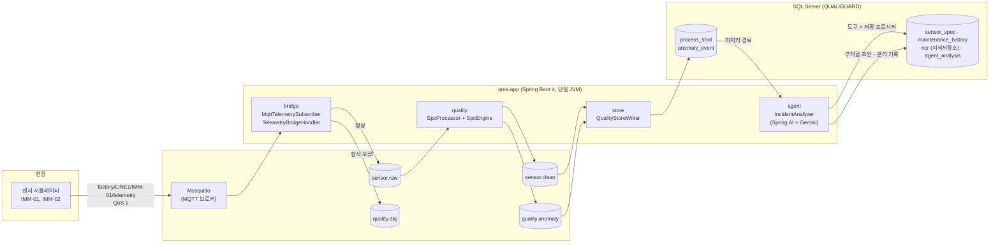

# 02. 아키텍처

## 1. 전체 흐름



현장 쪽은 가볍고 연결이 불안정해도 견디는 **MQTT**, 사내 시스템 쪽은 메시지를 디스크에 보관하고 여러 소비자가 다시 읽을 수 있는 **Kafka**를 씁니다. 실제 제조 현장에서 많이 쓰는 "현장은 MQTT, 사내 연계는 Kafka" 구성입니다.

## 2. 구성 요소

| 구성 요소 | 위치 | 역할 |
|---|---|---|
| 센서 시뮬레이터 | `simulator/` | 사출성형기가 shot마다 센서 7종과 비전 검사 결과를 발행. 고장 시나리오 4종 주입, 평가용 정답 CSV 기록 |
| Mosquitto | `docker-compose.yml` | MQTT 브로커. 지속 세션(persistence) 사용 |
| 브리지 | `qms-app/.../bridge/` | MQTT 구독 → 형식 검증 → 중복 제거 → Kafka 기록 → MQTT ack |
| 이상 탐지 | `qms-app/.../quality/` | Kafka Streams. 설비별 SPC 상태를 저장소에 두고 관리도 4종으로 판정 |
| Kafka | `docker-compose.yml` | KRaft 단일 노드. 토픽은 `kafka-init`이 명시적으로 생성 |
| DB 적재 | `qms-app/.../store/` | `sensor.clean`·`quality.anomaly`를 읽어 SQL Server에 저장 (`read_committed`, 중복 건너뜀) |
| 원인 분석 에이전트 | `qms-app/.../agent/` | 미처리 경보를 사건 단위로 묶어 분석, 부적합 초안 작성 |
| SQL Server | `docker-compose.yml`, `infra/mssql/init/` | 공정·이상·규격·정비·부적합 데이터, 저장 프로시저 6개 |

## 3. 메시지 형식

### MQTT / `sensor.raw` — shot 1건

```json
{
  "messageId": "b1c2…",
  "lineId": "LINE1",
  "equipmentId": "IMM-01",
  "shotNo": 301,
  "ts": "2026-11-14T16:20:01.123+09:00",
  "sensors": {
    "moldTemp":          {"value": 60.3,   "unit": "C"},
    "barrelTemp":        {"value": 229.1,  "unit": "C"},
    "injectionPressure": {"value": 1203.5, "unit": "bar"}
  },
  "inspection": {"result": "OK", "defectType": null},
  "bridge": {"receivedAt": "…", "sourceTopic": "factory/LINE1/IMM-01/telemetry"}
}
```
`bridge` 항목은 브리지가 추적용으로 덧붙입니다. Kafka 메시지 key는 `equipmentId`입니다.

### `quality.anomaly` — 이상 탐지 1건 (에이전트 입력)

| 필드 | 의미 |
|---|---|
| `rule`, `ruleName` | 판정 규칙 (INDIVIDUAL, XBAR, S_CHART, P_CHART) |
| `sensor`, `observed` | 규칙에 걸린 센서와 값 |
| `baselineMean`, `baselineSigma`, `lowerLimit`, `upperLimit` | 기준값과 관리 한계 |
| `recentValues` | 해당 센서의 최근 값 30개 |
| `sensorZScores` | **모든 센서**의 최근 5 shot 평균이 기준에서 몇 σ 벗어났는지 — 원인 추정의 핵심 단서 |
| `recentNgRate`, `recentDefectTypes` | 최근 50 shot 불량률과 불량 유형별 건수 |
| `message` | 사람이 읽을 수 있는 한 줄 설명 |

## 4. 전달 보장 설계

데이터가 사라지거나 두 번 처리되지 않도록 단계마다 장치를 두었습니다.

| 구간 | 위험 | 장치 |
|---|---|---|
| 시뮬레이터 → Mosquitto | 전송 중 유실 | QoS 1, 종료 전 미확인 메시지 대기 |
| Mosquitto → 브리지 | 브리지가 꺼진 동안 유실 | **지속 세션**(고정 client-id, cleanStart=false): 브로커가 메시지 보관 후 재접속 시 전달 |
| 브리지 → Kafka | 기록 실패인데 "받았다"고 응답 | **수동 ack**: Kafka 기록 성공 후에만 MQTT ack |
| QoS 1 재전송 | 같은 메시지 중복 | 브리지 메모리 중복 제거 (최근 10만 건) |
| 브리지 재시작 | 중복 제거 기록 소실 | 이상 탐지 단계에서 설비별 상태로 **한 번 더** 중복 제거 |
| Kafka 기록 재시도 | 같은 메시지 두 번 기록 | 멱등 프로듀서 (`enable.idempotence=true`, `acks=all`) |
| 이상 탐지 재처리 | 경보 중복 발행 | Kafka Streams **exactly-once v2** |
| DB 적재 | 같은 메시지 두 번 저장, 취소된 트랜잭션 메시지 저장 | `INSERT ... WHERE NOT EXISTS` + 고유 인덱스, `read_committed` |
| 에이전트 | 같은 원인의 보고서 중복 | 사건 단위 묶기, 같은 원인 초안이 있으면 연결 |
| 형식 오류 | 조용히 버려짐 | DLQ에 오류 사유와 함께 보관 |

## 5. 이상 탐지 (SPC)

| 단계 | 내용 |
|---|---|
| 기준 구간 (Phase I) | 설비별 처음 100 shot으로 센서별 평균(μ)·표준편차(σ), 기준 불량률 추정 |
| 개별값 | 한 값이 μ ± 4σ 밖 → 값 튐 |
| X̄ 관리도 | 5 shot 부분군 평균이 μ ± 3σ/√5 밖, **연속 2회** → 평균 이동 |
| S 관리도 | 부분군 표준편차가 1.964σ(B6, n=5) 초과, **연속 2회** → 산포 증가 |
| p 관리도 | 50 shot 구간 불량률이 p̄ + 4√(p̄(1−p̄)/50) 초과 → 불량률 증가 |
| 반복 억제 | 같은 규칙·센서 경보는 100 shot 동안 재발행하지 않음 |

핵심 로직(`SpcEngine`)은 Kafka·Spring에 의존하지 않는 순수 Java라 단위 테스트로 단독 검증합니다.

## 6. 자원 제약 (8GB RAM 개발 PC)

| 구성 요소 | 메모리 상한 |
|---|---|
| Mosquitto | 64MB |
| Kafka | 900MB (힙 512MB) |
| SQL Server | 2.5GB (엔진 내부 2GB) |
| qms-app | JVM 힙 384MB |

브리지·이상 탐지·(예정) 에이전트·화면을 **하나의 Spring Boot 앱 안에 모듈로** 둔 것도 JVM을 하나만 띄우기 위해서입니다. 운영 환경이라면 모듈별로 분리 배포할 수 있게 패키지를 나눠 두었습니다.

## 7. DB 설계 (SQL Server)

| 테이블 | 내용 |
|---|---|
| `equipment`, `sensor_spec` | 설비 마스터, 센서별 검사 규격(LSL/목표/USL) |
| `process_shot` | shot 단위 공정 데이터 (`sensor.clean` 적재) |
| `anomaly_event` | 이상 이력. 상태: NEW → ANALYZING → NCR_DRAFTED / DISMISSED |
| `maintenance_history` | 설비 정비 이력 |
| `ncr`, `ncr_anomaly` | 부적합 보고서(과거 사례 + 에이전트 초안)와 경보 연결 |
| `agent_analysis` | 에이전트 분석 기록: 판단, 원인, 확신도, 도구 호출 순서, 소요 시간 |

조회는 저장 프로시저 6개로 제공하며, 에이전트 도구와 QMS 화면이 함께 씁니다. 자세한 결정은 [ADR-007](decisions/ADR-007-sqlserver-qms-schema.md)에 있습니다.

## 8. 원인 분석 에이전트

```
미처리 경보 ─ ① 사건 묶기 (같은 설비, 100 shot·30분 안)
           ─ ② 조사 (도구 5개 = 저장 프로시저, 경보 당시까지의 데이터만)
                getSpcSummary → getSensorTrend → getDefectSummary → findSimilarNcr → getMaintenanceHistory
           ─ ③ 결과 (판단 / 원인 코드 / 확신도 / 현상 / 추정 원인 / 근거 / 참고 사례 / 권고 조치)
           ─ ④ 저장 (한 트랜잭션)
                NCR_DRAFT → 부적합 초안 (같은 원인 초안이 있으면 연결)
                SENSOR_CHECK, OBSERVE → 경보 종결
                + agent_analysis 기록
```

| API | 용도 |
|---|---|
| `GET /api/agent/anomalies` | 경보 목록 |
| `POST /api/agent/analyze-next` | 가장 오래된 미처리 사건 1건 분석 |
| `POST /api/agent/analyze/{anomalyId}` | 지정 경보를 시작점으로 분석 |
| `GET /api/agent/analyses` | 분석 기록 |

자동 분석은 기본으로 꺼져 있습니다 (`qg.agent.auto-enabled`). 자세한 결정은 [ADR-008](decisions/ADR-008-agent-design.md)에 있습니다.
