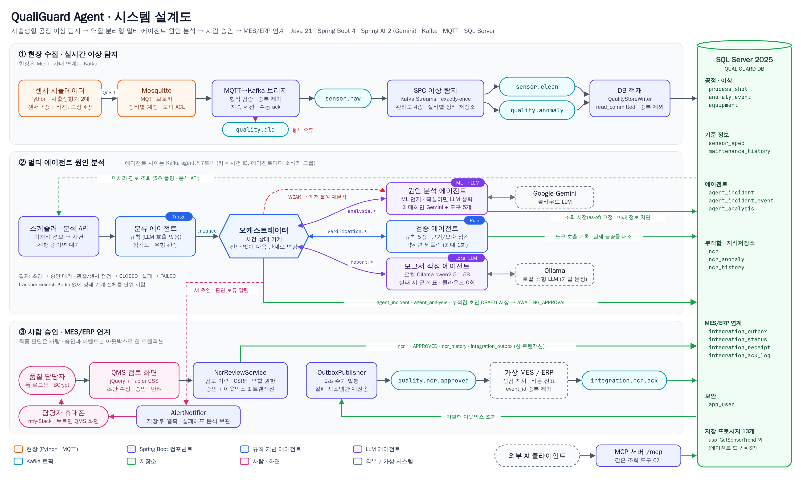
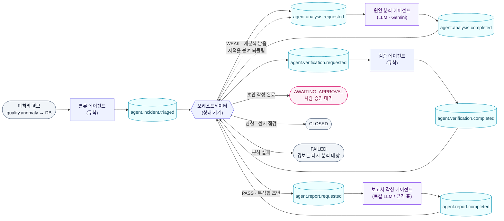
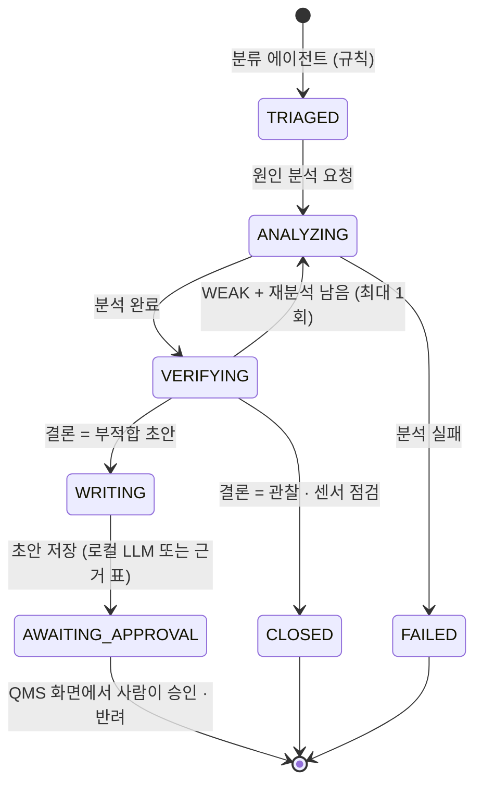
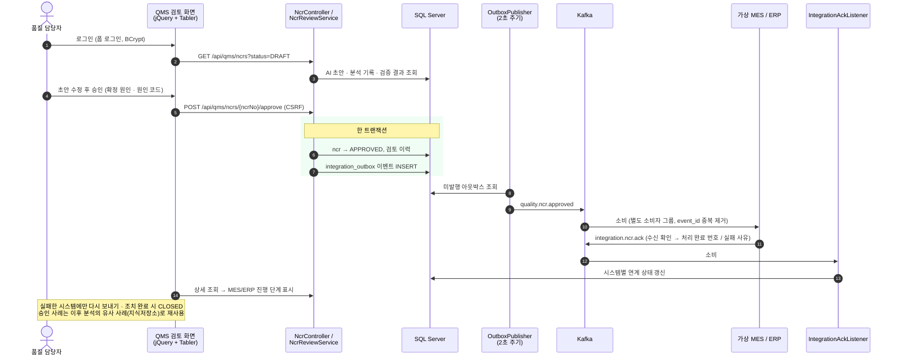

# 04. 시스템 설계도

포트폴리오·발표용으로 QualiGuard Agent 의 현재 구조를 한 장씩 그린 문서입니다. 모두 `main` 의 코드를 읽고 그렸습니다 (클래스·토픽·테이블 이름은 코드와 같습니다). 구성 요소별 설명은 [02. 아키텍처](02-architecture.md), 멀티 에이전트 결정은 [ADR-016](decisions/ADR-016-multi-agent-pipeline.md)에 있습니다.

| 그림 | 보여 주는 것 | 파일 |
|---|---|---|
| ① 전체 시스템 | 현장 수집 → SPC 탐지 → 멀티 에이전트 → 사람 승인 → MES/ERP | [PNG](architecture/qualiguard-architecture.png) · [SVG](architecture/qualiguard-architecture.svg) |
| ② 에이전트 파이프라인 | 에이전트 4개와 오케스트레이터를 잇는 Kafka `agent.*` 7토픽 | [PNG](architecture/agent-pipeline.png) · [SVG](architecture/agent-pipeline.svg) · [Mermaid](architecture/agent-pipeline.mmd) |
| ③ 사건 상태 | 오케스트레이터 상태 기계 (되돌림·종결·실패) | [PNG](architecture/incident-state.png) · [SVG](architecture/incident-state.svg) · [Mermaid](architecture/incident-state.mmd) |
| ④ 승인·연계 순서 | 승인 + 아웃박스 한 트랜잭션 → MES/ERP 응답 | [PNG](architecture/approval-integration.png) · [SVG](architecture/approval-integration.svg) · [Mermaid](architecture/approval-integration.mmd) |

## ① 전체 시스템



세 줄(lane)로 읽습니다. 오른쪽 SQL Server 가 세 단계를 잇는 기준 저장소입니다.

1. **현장 수집 · 실시간 이상 탐지** — Python 시뮬레이터가 shot마다 MQTT(QoS 1)로 발행 → Mosquitto(장비별 계정·토픽 ACL) → 브리지가 검증·중복 제거 후 `sensor.raw` (형식 오류는 `quality.dlq`) → Kafka Streams SPC 가 관리도 4종으로 판정해 `sensor.clean`·`quality.anomaly` → `QualityStoreWriter` 가 DB 적재.
2. **멀티 에이전트 원인 분석** — 스케줄러(5초 폴링) 또는 분석 API 가 미처리 경보를 사건으로 넣으면, 분류(규칙) → 오케스트레이터 → 원인 분석(Gemini, 도구 = 저장 프로시저, 조회 시점 고정) → 검증(규칙, 약하면 최대 1회 되돌림) → 보고서 작성(로컬 Ollama, 실패 시 근거 표·클라우드 0회) 순서로 흐릅니다. 결과는 `agent_incident`·`agent_analysis`·부적합 초안(DRAFT)으로 저장됩니다.
3. **사람 승인 · MES/ERP 연계** — 품질 담당자가 QMS 화면(jQuery + Tabler, Spring Security 로그인)에서 초안을 수정·승인·반려합니다. 승인과 `integration_outbox` 기록은 한 트랜잭션이고, `OutboxPublisher` 가 2초마다 `quality.ncr.approved` 로 발행 → 가상 MES/ERP 가 `integration.ncr.ack` 로 응답 → 연계 상태가 DB 에 반영됩니다.

같은 조회 도구는 MCP 서버(`/mcp`)로도 열려 있어 다른 AI 클라이언트가 쓸 수 있습니다.

> 그림 원본은 [`architecture/generate_overview.py`](architecture/generate_overview.py) 로 만든 SVG 입니다 (`python3 generate_overview.py out.svg`). 구조가 바뀌면 이 스크립트의 좌표·문구를 고쳐 다시 만듭니다.

## ② 에이전트 파이프라인 (Kafka `agent.*`)

메시지는 사건 ID + 요약만 담고, 키가 사건 ID 라 한 사건의 이벤트는 같은 파티션에서 순서대로 처리됩니다. 에이전트마다 소비자 그룹이 따로 있습니다 (`qg-agent-orchestrator`, `qg-agent-analysis`, `qg-agent-verifier`, `qg-agent-writer`).



| 에이전트 | 코드 | 방식 | 하는 일 |
|---|---|---|---|
| 분류 | `TriageAgent` | 규칙 | 심각도(P_CHART=HIGH, XBAR·S_CHART=MEDIUM, INDIVIDUAL=LOW)·유형 판정, 같은 설비 경보를 사건으로 묶음 |
| 오케스트레이터 | `IncidentOrchestrator` | 상태 기계 | 다음 에이전트에게 넘기기, 되돌림 횟수 제한. 스스로 판단하지 않음 |
| 원인 분석 | `AnalysisAgent` → `IncidentAnalyzer` | LLM (Spring AI + Gemini) | 도구 5개(`getSpcSummary`, `getSensorTrend`, `getDefectSummary`, `findSimilarNcr`, `getMaintenanceHistory`)로 근거 수집 후 판단 |
| 검증 | `VerifierStage` → `VerifierAgent` | 규칙 | 조사 충분성·근거 수치·판단 정합·사례 실재·데이터 대조 5종 |
| 보고서 작성 | `ReportWriterAgent` | 로컬 LLM / 근거 표 | 판단은 바꾸지 않고 문장만 작성. 기밀 데이터는 로컬 모델에만 |

`qg.agent.pipeline.transport=direct` 로 바꾸면 Kafka 없이 같은 스레드에서 이어 불러, 단위 시험(`AgentPipelineTest`)이 상태 기계 전체를 확인합니다.

## ③ 사건 상태



## ④ 승인 · MES/ERP 연계 순서



> ④는 **현재 구현(Kafka)** 순서입니다. 인터페이스(EAI) 서버로 바꾼 뒤의 계획 순서도는 [06. MES/ERP 연계 EAI 계획](06-mes-erp-eai-plan.md) 3장에 있습니다.

## 다시 렌더링하기

```bash
# Mermaid → SVG/PNG (mermaid-cli)
npx -p @mermaid-js/mermaid-cli mmdc -i docs/architecture/agent-pipeline.mmd -o docs/architecture/agent-pipeline.svg -b white
# 전체 시스템 그림
python3 docs/architecture/generate_overview.py docs/architecture/qualiguard-architecture.svg
```
