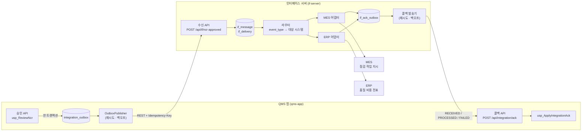
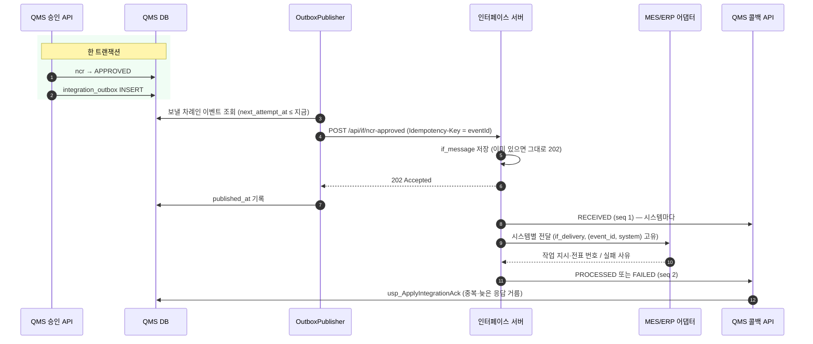

# 06. MES/ERP 연계를 EAI(인터페이스 서버) 방식으로 바꾸는 계획

> **상태: 계획 (아직 코드에 없음).** 지금 코드는 아래 "현재 구현"대로 Kafka 로 연계합니다. 이 문서의 "계획" 부분은 직접 손으로 구현할 설계와 순서입니다. 결정 기록은 [ADR-018](decisions/ADR-018-mes-erp-eai-interface-server.md)에 있습니다.

## 한 줄 요약

**아웃박스는 그대로 두고, Kafka 대신 인터페이스(연계) 서버를 REST 로 호출합니다.** 인터페이스 서버가 MES·ERP 어댑터로 나눠 보내고, 처리 결과는 콜백으로 QMS 에 돌려줍니다. 센서 이벤트·에이전트 이벤트는 계속 Kafka 를 씁니다.

---

## 1. 왜 바꾸는가

| 근거 | 설명 |
|---|---|
| **양이 적다** | NCR 승인은 하루 몇 건에서 몇십 건입니다. 아웃박스에 실시간으로 많은 데이터가 쌓이지 않습니다. Kafka 를 고른 이유는 양이 아니었습니다. |
| **제조 현장에서 흔한 방식** | MES/ERP 연계는 EAI(Enterprise Application Integration)나 인터페이스 서버를 두는 경우가 많습니다. 인터페이스 정의서(I/F ID, 송수신 시스템, 항목)와 연계 이력 화면으로 운영하는 방식이 익숙합니다. |
| **운영이 단순** | MES/ERP 담당자는 REST 와 연계 이력 테이블로 문제를 추적할 수 있습니다. Kafka 토픽·소비자 그룹·오프셋을 알 필요가 없습니다. |
| **보장은 그대로** | "한 번만 처리"는 Kafka 가 아니라 **아웃박스 + 재시도 + 받는 쪽 중복 제거**가 만들어 줍니다. 이 세 가지는 REST 로 바꿔도 그대로 유지됩니다. |

Kafka 는 **센서 데이터(초당 수십 shot, 재처리·상태 저장 필요)** 와 **에이전트 이벤트(`agent.*`)** 에 계속 씁니다. 양과 성격이 다른 두 흐름에 같은 도구를 고집하지 않는 것이 이번 결정의 요지입니다.

---

## 2. 현재 구현 vs 계획

| 항목 | 현재 구현 (코드에 있음) | 계획 (EAI) |
|---|---|---|
| 승인 → 이벤트 기록 | `usp_ReviewNcr` 가 같은 트랜잭션에서 `usp_EnqueueNcrApproved` → `integration_outbox` | **그대로** |
| 발행 | `OutboxPublisher` 가 2초마다 Kafka `quality.ncr.approved` 로 전송, 기록 확인 뒤 `published_at` | `OutboxPublisher` 가 **인터페이스 서버 REST 호출**, 202 응답을 받은 뒤 `published_at`. 실패 시 **지수 백오프** 재시도 |
| 받는 쪽 | 같은 앱의 `MesErpReceiver` (`@KafkaListener`, 그룹 `qg-mes-erp-sim`) | **인터페이스 서버** (`if-server`)가 받아 저장 → 라우팅 → MES/ERP **어댑터** 호출 |
| 중복 제거 | `integration_receipt` 의 `(event_id, system_name)` 고유 + `NOT EXISTS` | 인터페이스 서버의 `if_delivery` 에 `(event_id, system_name)` 고유 + `Idempotency-Key` 헤더 |
| 응답 | `integration.ncr.ack` 토픽 → `IntegrationAckListener` (그룹 `qg-qms-ack`) | 인터페이스 서버가 QMS **콜백 API** `POST /api/integration/ack` 호출 (콜백도 아웃박스 + 재시도) |
| 응답 반영 | `usp_ApplyIntegrationAck` (response_id 중복 제거, seq 큰 것만) | **그대로** (프로시저 재사용) |
| 실패 다시 보내기 | 새 `event_id` + `targetSystems` | **그대로** |
| 응답 시간 초과 | 감시 없음 | 인터페이스 서버 상태 조회 API 로 확인 가능 (감시는 2단계) |
| 전환 스위치 | — | `qg.integration.transport: kafka \| eai` (에이전트의 `qg.agent.pipeline.transport` 와 같은 방식) |

---

## 3. 계획한 구조

### 승인부터 응답까지 순서

---

## 4. 설계 상세

### 4-1. 아웃박스는 그대로, 발행 대상만 바뀐다
- 승인과 이벤트 기록이 한 트랜잭션이라는 핵심은 바뀌지 않습니다. 바뀌는 것은 `OutboxPublisher` 의 "보내는 곳"뿐입니다.
- 보내는 부분을 인터페이스로 뽑습니다: `IntegrationSender` (`send(OutboxEvent)`) — 구현 `KafkaIntegrationSender`(지금 코드를 옮김), `RestIntegrationSender`(새로). 설정 `qg.integration.transport` 로 고릅니다. 이렇게 하면 데모 영상의 Kafka 흐름도 그대로 돌려볼 수 있습니다.
- `integration_outbox` 에 열 2개를 추가합니다.

| 열 | 용도 |
|---|---|
| `next_attempt_at DATETIMEOFFSET(3) NULL` | 다음 재시도 시각. NULL 이면 바로 보냄 |
| `status VARCHAR(10)` | `PENDING` / `SENT` / `DEAD`(재시도 한도 초과). 지금은 `published_at`·`attempts` 로 추측하던 것을 명시 |

### 4-2. 재시도와 백오프
- 대기 시간 = `min(2초 × 2^(attempts-1), 5분)` + 0~20% 무작위(여러 건이 한꺼번에 몰리지 않게). 예: 2초, 4초, 8초 … 5분.
- 최대 10회(지금 `MAX_ATTEMPTS` 와 같음). 넘으면 `status = DEAD`, 화면에 "연계 전송 실패(관리자 확인)"로 표시합니다.
- 응답 코드별 처리:

| 응답 | 의미 | 처리 |
|---|---|---|
| 202 Accepted | 인터페이스 서버가 저장함 | `SENT`, `published_at` 기록 |
| 200 + `duplicate: true` | 이미 받은 이벤트 | 성공으로 봄 (`SENT`) |
| 400 / 422 | 형식·항목 오류 — 다시 보내도 같음 | 재시도 없이 `DEAD`, `last_error` 기록 |
| 401 / 403 | 인증 설정 오류 | 재시도는 하되 경고 로그 (설정 고치면 회복) |
| 429 / 5xx / 시간 초과 / 연결 실패 | 일시적 | 백오프 후 재시도 |

- 순서: 지금처럼 **오래된 순으로 보내고, 일시적 실패가 나면 그 주기는 멈춥니다**(같은 설비 이벤트가 앞질러 가지 않게). 영구 오류(`DEAD`)는 건너뜁니다.
- 연결 시간 초과 2초, 읽기 시간 초과 5초 (`qg.integration.eai.connect-timeout-ms`, `read-timeout-ms`).

### 4-3. 인터페이스 서버의 역할
인터페이스 서버는 **"받아서 저장하고, 시스템별로 나눠 보내고, 결과를 알려 주는"** 일만 합니다. 업무 판단은 하지 않습니다.

| 기능 | 내용 |
|---|---|
| 수신 API | `POST /api/if/ncr-approved` — 헤더 `Idempotency-Key: {eventId}`, `X-IF-Id: IF-QMS-001`. 받은 JSON 을 `if_message` 에 저장하고 **저장 직후 202** 를 돌려줌 (MES/ERP 처리는 기다리지 않음) |
| 라우팅 | `if_route` 테이블: `(if_id, event_type) → 대상 시스템 목록`. `NCR_APPROVED → MES, ERP`. `targetSystems` 가 있으면 그 시스템만 |
| 어댑터 | `MesAdapter`, `ErpAdapter` — 인터페이스 `SystemAdapter.deliver(payload) → AdapterResult(referenceNo | error)`. 지금은 가상(현재 `MesErpReceiver` 의 업무 생성 규칙과 `simulate-failure` 를 옮김). 실제 연동 시 이 클래스만 교체 |
| 중복 제거 | `if_message.event_id` 기본 키, `if_delivery` 의 `(event_id, system_name)` 고유. 같은 이벤트가 다시 와도 업무를 다시 만들지 않음 |
| 결과 알림 | 시스템마다 `RECEIVED`(seq 1) → `PROCESSED`(seq 2, 번호) / `FAILED`(seq 2, 사유)를 `if_ack_outbox` 에 쓰고, 발송기가 QMS 콜백 API 로 전송 (재시도·백오프는 4-2 와 같은 규칙) |
| 연계 이력 조회 | `GET /api/if/events/{eventId}` — 시스템별 전달 상태. 운영자가 장애를 추적할 때 씀 |

**응답 ID** 는 지금과 같이 `(eventId, system, seq)` 에서 UUID v3 로 계산합니다. 콜백이 두 번 가도 QMS 의 `integration_ack_log` 기본 키가 거릅니다.

### 4-4. QMS 콜백 API
- `POST /api/integration/ack` — 본문은 지금 `integration.ncr.ack` 메시지와 **같은 형식**(`responseId, eventId, ncrNo, system, status, seq, referenceNo, message`).
- 내부에서 `usp_ApplyIntegrationAck` 를 그대로 부릅니다. 결과 `APPLIED`/`DUPLICATE`/`STALE` 모두 **200** 으로 답합니다(중복도 정상 처리로 봐야 인터페이스 서버가 재시도를 멈춤).
- 인증: 사람 로그인(폼)이 아니라 **서비스 토큰**(`Authorization: Bearer ${QG_IF_CALLBACK_TOKEN}`)으로 막고, CSRF 대상에서 뺍니다. 운영이라면 내부망 제한이나 mTLS 를 더합니다.

### 4-5. 데이터 테이블 (인터페이스 서버)

| 테이블 | 열 | 설명 |
|---|---|---|
| `if_message` | `event_id`(PK), `if_id`, `event_type`, `source_system`, `payload`, `received_at` | 받은 원문. 재처리 근거 |
| `if_route` | `if_id`, `event_type`, `target_system`, `enabled` | 라우팅 규칙 (코드 수정 없이 대상 추가) |
| `if_delivery` | `event_id`, `system_name`(고유 쌍), `status`, `reference_no`, `error`, `attempts`, `updated_at` | 시스템별 전달 결과 |
| `if_ack_outbox` | `response_id`(PK), `event_id`, `system_name`, `status`, `seq`, `payload`, `sent_at`, `attempts`, `next_attempt_at` | 콜백 아웃박스 |

> 8GB 개발 PC 제약 때문에, 처음에는 **같은 SQL Server 의 별도 스키마(`ifs`)** 에 둡니다. 운영이라면 인터페이스 서버 전용 DB 를 씁니다.

### 4-6. 배포 형태
| 선택지 | 장단점 |
|---|---|
| **별도 Spring Boot 앱 `if-server` (권장, 1단계)** | 실제 구성과 같음. JVM 하나 더(힙 256MB 제한이면 8GB 에서도 가능). 모듈 경계가 분명해 면접 설명이 쉬움 |
| 같은 앱의 `eai/` 패키지 + REST 자기 호출 | 메모리 절약. 하지만 "연계 서버를 두었다"는 의미가 약함 — 메모리가 부족할 때의 대안 |

---

## 5. 트레이드오프 — Kafka 와 비교

| 기준 | Kafka (현재) | EAI / 인터페이스 서버 (계획) |
|---|---|---|
| 처리량 | 매우 높음 | 낮음 — 하루 수십 건이면 충분 |
| 결합도 | QMS 는 토픽에 넣기만 함. 받는 쪽이 늘어도 QMS 수정 없음 | QMS 는 인터페이스 서버 하나만 앎. 받는 쪽 추가는 `if_route` + 어댑터로 (QMS 수정 없음) |
| 받는 쪽 장애 | 메시지가 토픽에 남아 나중에 읽음 | 인터페이스 서버가 받아 두면 MES/ERP 장애는 서버 안에서 재시도. **인터페이스 서버가 죽으면** 아웃박스에 쌓였다가 복구 후 전송 |
| 다시 읽기(replay) | 보관 기간 안이면 오프셋을 돌려 다시 읽음 | `if_message` 원문으로 재처리 (직접 만들어야 함) |
| 순서 | 파티션 key(설비 ID) 기준 보장 | 발행기가 오래된 순 + 실패 시 멈춤으로 보장. 인터페이스 서버 안에서는 시스템별로 순서대로 처리해야 함 |
| 운영·추적 | 토픽·소비자 그룹·오프셋을 알아야 함 | 연계 이력 테이블·HTTP 로그로 추적. 현장 MES/ERP 담당자에게 익숙 |
| 보안 | Kafka ACL·SASL | 서비스 토큰·mTLS·내부망 제한 |
| 구성 요소 | 이미 있는 Kafka 재사용 | 인터페이스 서버를 하나 더 운영 |
| 보장 수준 | at-least-once + 받는 쪽 중복 제거 | **같음** — at-least-once 가 두 구간(발행, 콜백)으로 늘 뿐, 양쪽 다 중복 제거 |

**잃는 것**: Kafka 의 보관·다시 읽기와 "소비자를 붙이기만 하면 되는" 확장성. 알림·통계 같은 소비자가 많이 늘어날 계획이라면 Kafka 가 더 낫습니다.
**얻는 것**: 적은 양에 맞는 단순한 구성, 현장에 익숙한 운영 방식, 연계 이력을 한곳(인터페이스 서버)에서 보는 추적성.

---

## 6. 면접 답변

> "처음에는 이미 센서용으로 쓰던 Kafka 를 재사용해 승인 결과를 보냈습니다. 그런데 NCR 승인은 하루 수십 건 수준이라 Kafka 의 처리량·보관 장점이 필요 없었고, 제조 현장의 MES/ERP 연계는 EAI·인터페이스 서버로 운영하는 경우가 많아 그 방식으로 바꾸는 중입니다. 중요한 건 '한 번만 처리'를 Kafka 가 아니라 트랜잭션 아웃박스, 재시도, 받는 쪽 `(event_id, 시스템)` 중복 제거가 보장한다는 점이라, 전송 수단만 바꾸고 이 세 가지는 그대로 유지했습니다. 대신 Kafka 의 다시 읽기 기능이 없어져서, 인터페이스 서버에 받은 원문을 저장해 재처리할 수 있게 설계했습니다."

예상 꼬리 질문:
- **"인터페이스 서버가 죽으면?"** → 아웃박스에 `PENDING` 으로 남고 백오프로 계속 시도합니다. 승인 자체는 막히지 않습니다.
- **"202 를 받기 전에 QMS 가 죽으면?"** → `published_at` 이 비어 있어 다시 보냅니다. 인터페이스 서버는 `Idempotency-Key`(eventId) 로 같은 이벤트임을 알고 다시 처리하지 않습니다.
- **"콜백이 순서가 바뀌어 오면?"** → 지금과 같이 seq 가 큰 응답만 상태를 바꿉니다(`usp_ApplyIntegrationAck`).
- **"왜 동기 처리(MES/ERP 결과까지 기다림)가 아닌가?"** → MES/ERP 가 느리거나 죽어 있으면 QMS 발행기가 함께 막힙니다. 202 로 끊고 결과는 콜백으로 받는 비동기 방식이 장애를 격리합니다.

---

## 7. 손코딩 체크리스트

순서대로 하면 각 단계마다 앱이 정상 동작합니다. 단계마다 테스트를 먼저 쓰거나 함께 쓰세요.

### 1단계 — QMS 쪽 준비 (Kafka 동작 그대로 유지)
- [ ] `IntegrationSender` 인터페이스 만들기, 지금 `OutboxPublisher` 의 Kafka 전송 부분을 `KafkaIntegrationSender` 로 옮기기
- [ ] 설정 `qg.integration.transport: kafka` 추가, `@ConditionalOnProperty` 로 구현 선택
- [ ] `OutboxPublisherTest` 가 그대로 통과하는지 확인 (동작 변화 없음)
- [ ] SQL 스크립트 `infra/mssql/init/16_integration_eai.sql`: `integration_outbox` 에 `next_attempt_at`, `status` 열 추가 (여러 번 실행해도 안전하게 `IF COL_LENGTH(...) IS NULL`)
- [ ] 발행기 조회 조건에 `(next_attempt_at IS NULL OR next_attempt_at <= SYSDATETIMEOFFSET())` 와 `status = 'PENDING'` 추가

### 2단계 — 인터페이스 서버 만들기
- [ ] 새 모듈 `if-server/` (Spring Boot, `settings.gradle` 에 추가), 포트 8090
- [ ] 스키마 `ifs` 와 테이블 `if_message`, `if_route`, `if_delivery`, `if_ack_outbox` (4-5)
- [ ] `POST /api/if/ncr-approved`: `Idempotency-Key` 필수, `if_message` 에 `INSERT … WHERE NOT EXISTS` → 새로 넣었으면 202, 이미 있으면 200 `{duplicate: true}`
- [ ] 라우터: `if_route` 에서 대상 시스템 조회, `targetSystems` 있으면 교집합
- [ ] `SystemAdapter` 인터페이스 + `MesAdapter`, `ErpAdapter` (현재 `MesErpReceiver` 의 업무 생성·`simulate-failure` 규칙을 옮김)
- [ ] 전달 처리기(스케줄러): `if_delivery` 를 만들고 어댑터 호출, 결과를 같은 트랜잭션에서 `if_ack_outbox` 에 기록
- [ ] 응답 ID: `UUID.nameUUIDFromBytes(eventId + system + seq)` (지금 방식과 같게)
- [ ] `GET /api/if/events/{eventId}` 연계 이력 조회
- [ ] 테스트: 같은 eventId 두 번 → 업무 1건 / `targetSystems=ERP` → ERP 만 / 어댑터 실패 → FAILED 콜백

### 3단계 — QMS 가 REST 로 보내기
- [ ] `RestIntegrationSender` (Spring `RestClient`, 연결 2초·읽기 5초 시간 초과)
- [ ] 응답 코드 분류(4-2 표): 성공 / 영구 실패(`DEAD`) / 일시 실패(백오프)
- [ ] 백오프 계산 함수를 따로 두고 단위 테스트 (2, 4, 8 … 300초 상한, 무작위 범위)
- [ ] `DEAD` 이벤트를 상세 화면 "MES/ERP 연계"에 표시
- [ ] 테스트: MockWebServer(또는 `MockRestServiceServer`)로 503 → 재시도, 400 → DEAD, 202 → SENT, 시간 초과 → 재시도

### 4단계 — 콜백 받기
- [ ] `POST /api/integration/ack` 컨트롤러 → `usp_ApplyIntegrationAck` 호출, 결과와 상관없이 200
- [ ] 서비스 토큰 필터 (`QG_IF_CALLBACK_TOKEN`, `.env` 에 넣고 커밋 금지), 이 경로만 CSRF 제외
- [ ] 인터페이스 서버 콜백 발송기: `if_ack_outbox` 를 오래된 순으로, 4-2 와 같은 백오프
- [ ] 테스트: 같은 응답 두 번 → DUPLICATE, seq 1 이 늦게 → STALE, 토큰 없음 → 401

### 5단계 — 전환과 확인
- [ ] `qg.integration.transport: eai` 로 바꾸면 `MesErpReceiver`·`IntegrationAckListener` 가 뜨지 않게 (`@ConditionalOnProperty`)
- [ ] E2E: 초안 승인 → 연계 화면에 MES·ERP 처리 완료 번호 확인
- [ ] 장애 시험 ① `if-server` 끄고 승인 → 아웃박스 `PENDING`·attempts 증가 → 켜면 전송
- [ ] 장애 시험 ② `simulate-failure=ERP` → ERP 만 FAILED → 다시 보내기 → ERP 만 처리, MES 업무 중복 없음
- [ ] 장애 시험 ③ 콜백 중 QMS 끄기 → 인터페이스 서버 재시도 → QMS 켜면 상태 반영
- [ ] 문서 갱신: ADR-018 상태를 "채택"으로, [02 아키텍처](02-architecture.md) 4·9장, [04 설계도](04-architecture-diagram.md) ④ 순서도, README 아키텍처 그림
- [ ] (선택) 인터페이스 정의서 표 `docs/interfaces/IF-QMS-001.md` — I/F ID, 송신 QMS, 수신 MES/ERP, 방식 REST, 항목 정의

### 2차로 미뤄도 되는 것
- 응답 시간 초과 감시 (예: 10분 동안 PROCESSED/FAILED 가 없으면 화면 경고) — [향후 계획](future-work.md)의 "MES/ERP 응답 시간 초과 감시"
- `DEAD` 이벤트를 관리자가 다시 `PENDING` 으로 돌리는 API
- mTLS

---

## 관련 문서
- [ADR-018 MES/ERP 연계를 인터페이스 서버로](decisions/ADR-018-mes-erp-eai-interface-server.md)
- [ADR-010 아웃박스 연계](decisions/ADR-010-ncr-integration-outbox.md), [ADR-012 MES/ERP 응답](decisions/ADR-012-mes-erp-ack.md) — 현재 구현
- [아키텍처 4장 전달 보장](02-architecture.md), [한계와 보완할 점 10번](05-limitations-and-improvements.md)
