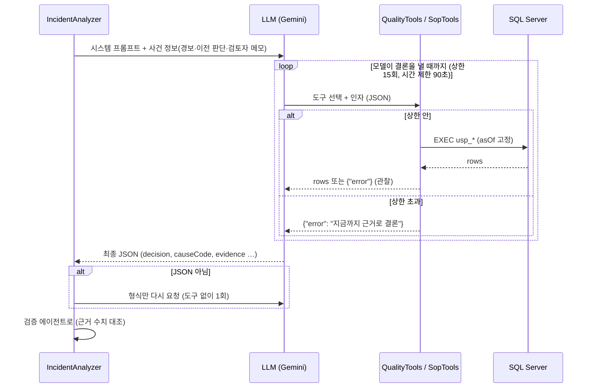

# 에이전트 도구 명세서 (Tool / Function Calling Spec)

| 항목 | 내용 |
|---|---|
| 대상 | 원인 분석 에이전트(`IncidentAnalyzer`)가 부르는 도구 6개, MCP 서버(`/mcp`)가 외부 AI 에 여는 도구 6개 |
| 코드 | `agent/QualityTools.java`, `agent/SopTools.java`, `mcp/McpQualityTools.java`, `infra/mssql/init/04_procedures.sql` |
| 관련 결정 | ADR-008(에이전트 설계), ADR-013(MCP), ADR-014(유사 사례 의미 검색), 장애 분석 04·06(미래 데이터 누수) |
| 기준 | main, 2026-11-23 |

## 1. 공통 규칙

| 규칙 | 내용 | 왜 |
|---|---|---|
| 스키마 | 메서드에 붙인 `@Tool(description)`·`@ToolParam(description, required)`로 Spring AI 가 JSON Schema 를 만들어 모델에 보낸다. 문서와 코드가 어긋나지 않게 설명은 코드에만 쓰고, 이 문서는 그 내용을 정리한다 | 명세의 원본을 하나로 |
| 조회 방식 | 공정 데이터 조회는 모두 SQL Server 저장 프로시저(`usp_*`). 모델은 SQL 을 쓰지 않는다 | 조회 범위·성능을 DB 쪽에서 통제 |
| 기준 시각 `asOf` | 서버가 사건의 경보 시각을 넣는다. **도구 인자로 노출하지 않아** 모델이 바꿀 수 없다 | 지난 경보를 나중에 분석해도 그 시점 데이터만 보게 (장애 분석 04) |
| 오류 | 예외를 던지지 않고 `[{"error": "원인 메시지"}]` 를 돌려준다. 모델이 인자를 고쳐 다시 부를 수 있다 | 없는 센서 키 같은 실수를 스스로 고치게 |
| 호출 상한 | 분석 1회 안에서 도구 호출 합계 15회(`qg.agent.max-tool-calls`). 넘으면 조회 없이 "지금까지 근거로 결론" 오류 | 무한 조회 방지 ([가드레일 G-03](guardrail-policy.md)) |
| 기록 | 호출마다 도구 이름·인자·분석 시작 후 경과 ms 를 trace 에 남기고 `agent_analysis.tool_trace` 로 저장 | 어떤 근거로 판단했는지 사람이 확인 |
| 수치 수집 | 공정 조회 결과의 수치를 `ToolObservations` 에 모아 검증 에이전트가 근거 수치와 대조 | 지어낸 숫자 차단 (규칙 6) |
| 기본값 | 정수 인자가 비거나 1 미만이면 기본값 사용 | 모델이 인자를 빠뜨려도 동작 |

## 2. 에이전트 도구 (6개)

### 2.1 getSensorTrend — 센서 추이

| 항목 | 내용 |
|---|---|
| 언제 | 경보 센서가 서서히 변했는지, 단발로 튀었는지 볼 때 (프롬프트 조사 절차 2단계) |
| 파라미터 | `equipmentId` string 필수 (예: IMM-01) · `sensorKey` string 필수 (moldTemp, barrelTemp, injectionPressure, holdingPressure, cushion, cycleTime, motorCurrent) · `lastShots` int (기본 300, 권장 넓게 300 / 좁게 60) · `bucketSize` int (기본 20, 권장 20 / 5) |
| 반환 (구간별 1행) | bucket_no, from/to_shot_no, from_ts, shots, avg_value, min_value, max_value, stdev_value, ng_count, inspected, lsl·target·usl |
| 프로시저 | `usp_GetSensorTrend` (asOf 적용) |
| 오류 | 등록되지 않은 설비·센서 → `THROW 50001`, 1 미만 인자 → `50002` → `{"error"}` 로 모델에 전달 |

### 2.2 getSpcSummary — 센서 전체 비교

| 항목 | 내용 |
|---|---|
| 언제 | 경보 센서 외에 함께 움직인 센서가 있는지 (조사 절차 1단계) |
| 파라미터 | `equipmentId` 필수 · `lastShots` int (기본 50) |
| 반환 (센서별 1행) | sensor_key, sensor_name, unit, shots, mean_value, stdev_value, cpk, out_of_spec_shots, capability(충분·보통·부족) |
| 프로시저 | `usp_GetSpcSummary` (asOf 적용) |

### 2.3 getDefectSummary — 불량 추이

| 항목 | 내용 |
|---|---|
| 언제 | 실제 품질 영향이 있었는지 (조사 절차 3단계) |
| 파라미터 | `equipmentId` 필수 · `lastShots` int (기본 300) · `windowSize` int (기본 50) |
| 반환 (구간별 1행) | window_no, from/to_shot_no, shots, inspected, ng_count, ng_rate_pct, short_shot, flash, dimension, warpage |
| 프로시저 | `usp_GetDefectSummary` (asOf 적용, 검사 결과 없는 shot 은 불량률 분모에서 제외, ADR-017) |

### 2.4 findSimilarNcr — 과거 사례 검색 (RAG)

| 항목 | 내용 |
|---|---|
| 언제 | 과거 확정 원인과 당시 근거를 지금 패턴과 비교할 때 (조사 절차 4단계) |
| 파라미터 | `equipmentId` 필수 · `sensorKeys` string 필수 (쉼표 구분) · `defectType` string 선택 · `situation` string 선택 (지금 현상 한두 문장 → 임베딩해 의미 검색) |
| 반환 (최대 5건) | ncr_no, equipment_id, defect_type, related_sensors, title, phenomenon, root_cause, evidence, action_taken, occurred_at, cause_code, source(사람 작성 / AI 초안을 사람이 승인), sensor_match, defect_match, same_equipment, semantic_similarity, score |
| 점수 | `센서 일치×2 + 불량 유형 일치×2 + 같은 설비 + (의미 유사도 ≥ 0.6 이면 (유사도−0.6)×10)`. 후보 조건: 센서 일치 > 0 또는 불량 유형 일치 또는 유사도 ≥ 0.75 |
| 프로시저 | `usp_FindSimilarNcr` (asOf 시점까지 **승인된** 사례만, 승인·종결 상태만) |
| 주의 | 프롬프트가 "결과에 실제로 있는 번호만 similarCases 에 넣으라"고 지시하고, 검증 에이전트가 인용 번호의 실재를 확인 |

### 2.5 getMaintenanceHistory — 정비 이력

| 항목 | 내용 |
|---|---|
| 언제 | 부품 교체 주기, 미실시 권고 등 단서 (조사 절차 5단계) |
| 파라미터 | `equipmentId` 필수 |
| 반환 (최근 10건) | maint_date, maint_type, part_name, description, technician, days_ago |
| 프로시저 | `usp_GetMaintenanceHistory` |
| 알려진 한계 | asOf 를 쓰지 않는다(정비 이력은 경보 뒤에 바뀌지 않는다는 가정). `days_ago` 는 오늘 기준. `technician`(담당자 이름)이 외부 LLM 으로 나간다 → [가드레일 정책서 미구현 항목](guardrail-policy.md#4-구현하지-않은-항목) |

### 2.6 searchSop — 현장 표준 절차 검색 (RAG)

| 항목 | 내용 |
|---|---|
| 언제 | 추정 원인에 맞는 점검·조치 절차를 찾아 recommendedAction 에 반영할 때 (조사 절차 6단계) |
| 파라미터 | `query` string 필수 (예: "barrelTemp 하락 사출 압력 상승 미성형 히터") |
| 반환 (상위 3건) | docId, title, section, text, score |
| 구현 | `SopLibrary` 앱 안 BM25 (DB 없음). 켜고 끄기 `qg.knowledge.sop.enabled` |
| 주의 | 결과는 공정 수치가 아니므로 검증 수치 대조에 넣지 않는다. 프롬프트가 "결과에 없는 문서 번호는 지어내지 말라"고 지시 |

## 3. MCP 도구 (외부 AI 클라이언트용, `/mcp`)

같은 `QualityTools` 를 감싸서 연다(ADR-013). 차이는 세 가지입니다.

| 차이 | 에이전트 도구 | MCP 도구 |
|---|---|---|
| 기준 시각 | 서버가 사건 시각을 넣음 | `anomalyId` 인자를 주면 그 경보 시각까지만, 없으면 최신까지 |
| 추가 도구 | — | `listAnomalies(equipmentId?, status?, top?)` 최근 경보 목록 (top 기본 20, 최대 200) |
| 인증 | 앱 내부 호출 | `Authorization: Bearer QG_AGENT_API_TOKEN` 필수 |
| 검증 수치 수집·호출 상한 | 적용 | 적용 안 함 (외부 클라이언트가 자기 루프를 관리) |

MCP 도구 6개: listAnomalies, getSpcSummary, getSensorTrend, getDefectSummary, findSimilarNcr, getMaintenanceHistory.

## 4. 도구 호출 루프 (분석 1회 안)

LangGraph 의 상태 그래프 대신, 루프 바깥(사건 상태·재분석·재확인)은 코드 상태 기계(`Incident.State`)가, 루프 안쪽(도구 선택·관찰)은 Spring AI 의 도구 호출이 맡습니다.

## 5. 변경할 때

1. 도구 설명은 `@Tool` 에서 고친다. 설명은 모델이 도구를 고르는 기준이므로 바꾸면 프롬프트를 바꾼 것과 같다 → [프롬프트 변경 이력](prompt-changelog.md)에 적고 재평가한다.
2. 반환 컬럼을 바꾸면 검증 에이전트 대조(`ToolObservations`)와 `QualityToolsAsOfTest` 를 함께 확인한다.
3. 새 공정 조회 도구는 반드시 asOf 를 받는 프로시저로 만든다.
