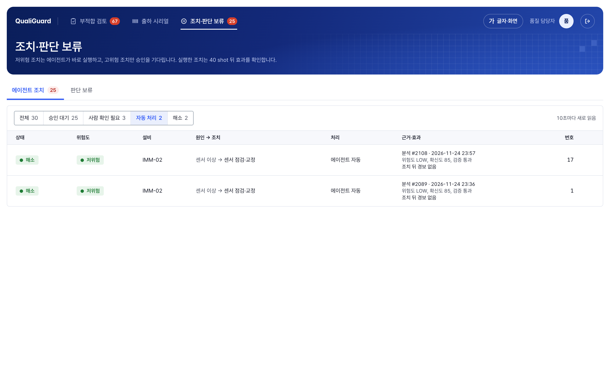
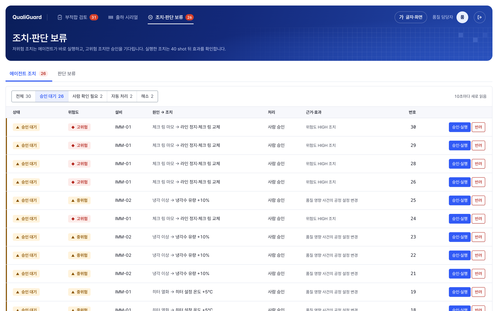
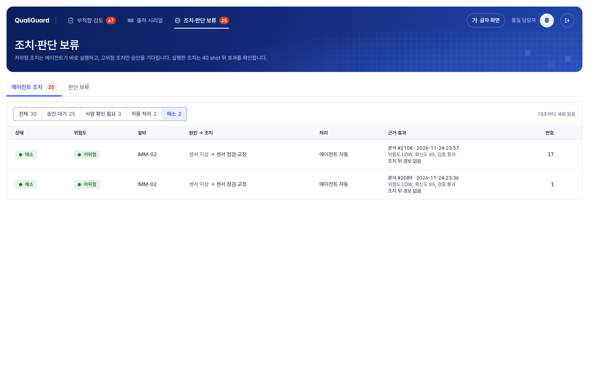
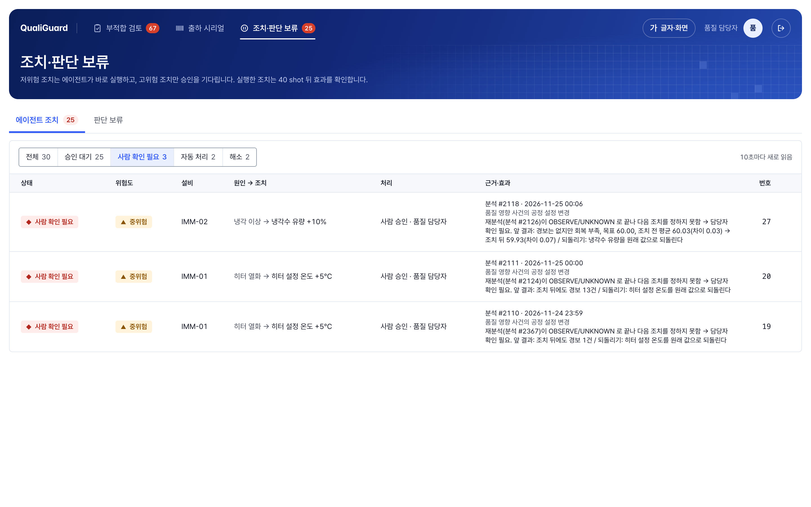

# 11. 자동 조치·효과 확인 루프를 실제로 돌려 보니 (로드맵 F3)

단위·컨테이너 테스트는 모두 통과했지만, 맥에서 앱과 시뮬레이터를 함께 몇 시간 돌리자 테스트에서 보지 못한 문제가 나왔다.
측정: 2026-11-24 저녁~11-25 새벽, 맥(M1), 기본 시나리오 2회.

## 화면

캡처는 11-25 재실행(#104·#105·#107 반영) 화면입니다.

| 자동 실행된 조치 | 승인 대기 조치 | 효과 확인(해소) | 담당자 확인 |
|---|---|---|---|
|  |  |  |  |
| 센서 재보정(LOW)이 확신도 85·검증 통과로 자동 실행되고 해소 | 히터·냉각·체크 링은 승인 대기. 같은 조치는 한 줄에 "같은 판단 N번 더" | 해소 2건 | 효과 없음 → 재분석이 관찰로 끝남 → ESCALATED 3건 |

11-24 밤 첫 실행 최종 상태: 조치 30건 (해소 2, 미해소 2, 승인 대기 26).

## 문제 1. 효과 확인이 영원히 오지 않음 → PR #103

- **현상**: 조치를 실행해도 효과 확인이 시작되지 않았다.
- **원인**: "조치 뒤 40 shot" 을 shot 번호로 셌는데, 시뮬레이터는 실행할 때마다 shot 번호를 1부터 다시 매긴다. 조치 시점의 shot 번호가 새 실행의 번호보다 크면 조건이 맞지 않는다.
- **조치**: shot 번호 대신 DB 에 들어온 시각(`created_at > executed_at`)으로 센다. 컨테이너 테스트에 번호 재시작 시나리오를 추가했다.
- **함께 고친 것**: 미해소 조치의 재분석이 다른 분석에 밀려 늦어지면, 그사이 자동 스케줄러가 새 경보를 먼저 집어 갔다. 재분석이 대기 중이면 자동 분석을 쉬게 했다.

## 문제 2. 같은 조치가 승인 대기에 26건 쌓임 → PR #104

- **현상**: 같은 설비의 같은 고장을 분석할 때마다 같은 조치가 새로 들어와, 담당자가 같은 승인 버튼을 26번 눌러야 했다. 조치 목록에 확신도도 보이지 않아 무엇을 먼저 볼지 알 수 없었다. 메뉴 배지 숫자(22)와 목록 건수(26)도 달랐다.
- **원인**: 조치를 만들 때 "같은 설비·같은 조치가 이미 진행 중인가"를 보지 않았다. 배지는 처음 한 번만 읽었다.
- **조치**: 진행 중(승인 대기·효과 확인 대기)인 같은 조치가 있으면 새로 만들지 않고 "같은 판단 N번 더 · 마지막 분석 #x" 로 묶는다. 목록에 확신도·검증 통과·분석 번호를 보이고, 배지는 30초마다 새로 읽는다.

## 문제 3. 미해소 뒤 재분석이 '관찰'로 끝나면 아무도 모름 → PR #105

- **현상**: 미해소 조치 2건(히터, 냉각수)의 재분석이 OBSERVE/UNKNOWN 으로 끝났다. 다음 조치가 없어 조치는 미해소 상태로 멈췄고 담당자 확인(ESCALATED)도 되지 않았다.
- **원인**: 담당자 확인으로 넘기는 경로가 "다음 조치도 효과 없음" 하나뿐이었다.
- **조치**: 재분석이 끝난 지 60초가 지나도 다음 조치가 없으면 ESCALATED 로 바꾸고 "재분석(분석 #N)이 관찰로 끝나 다음 조치를 정하지 못함 → 담당자 확인 필요" 를 남긴다.

## 재실행 (2026-11-25, #104·#105·#107 반영)

결과: [eval/overnight-1124/f3-rerun-1125.md](../../eval/overnight-1124/f3-rerun-1125.md)

- 어젯밤 미해소로 멈췄던 조치 2건이 ESCALATED 로 넘어갔다(#105).
- 새로 승인한 히터 조치 19 는 승인 → 40 shot 뒤 효과 없음 → 재분석 → 관찰 → 60초 뒤 ESCALATED 까지 한 번에 확인했다.
- 같은 고장의 새 판단 2건은 새 행 없이 기존 조치에 묶였다(#104).

## 문제 4. 재분석이 이전 실행의 shot 을 봄 → 이 문서와 같은 PR

- **현상**: 조치 19 의 재분석 #2367 이 기준 shot 2100 으로 분석했다. 지금 실행은 약 1700 이었다. 조용한 옛 구간을 보고 관찰로 끝나 곧바로 ESCALATED 가 됐다.
- **원인**: 재분석 기준을 `MAX(shot_no)` 로 골랐다. 문제 1과 같은 shot 번호 재시작 문제다.
- **조치**: 관찰 기준 시각 뒤에 들어온 shot 중 가장 늦게 들어온 것(`created_at`)을 기준으로 삼는다. 지난 shot 수도 시각으로 센다.

## 남은 것

- 해소(RESOLVED) 판정의 근거가 약하다. 조치 앞뒤 평균만 비교하므로, 고장이 저절로 사라지는 시뮬레이터 구간에서는 조치와 상관없이 해소로 나올 수 있다.
- 오래 돌리면 분석 몇 건이 DB 교착(deadlock)으로 FAILED 가 됐다. 원인은 아직 보지 않았다.
- #104 이전에 생긴 승인 대기 25건은 묶이지 않은 채 남고, 새 판단은 가장 오래된 행에 붙어 화면 아래쪽에 있다. 마지막 판단 시각순 정렬이 필요하다.
- 자동 분석이 가장 오래된 NEW 경보(평가 재생 데이터 포함)부터 처리해, 지금 실행의 경보가 뒤로 밀린다.
- 하루 토큰 예산이 평가 재생 토큰까지 함께 센다. 밤샘 평가가 11-25 예산을 10배 넘게 써서 자동 분석이 바로 멈췄다.
- 확신도 80 기준(#107)은 재실행에서 LOW 조치가 나오지 않아 시험으로만 확인했다.
- 실행이 끝났을 때 처리되지 않은 경보가 1,235건 남았다(재실행 뒤 2,085건). 하루 토큰 예산과 한 번에 하나씩 분석하는 구조 때문이며, 실제 라인에서는 사건 묶기·ML 먼저 판단으로 줄여야 한다.
